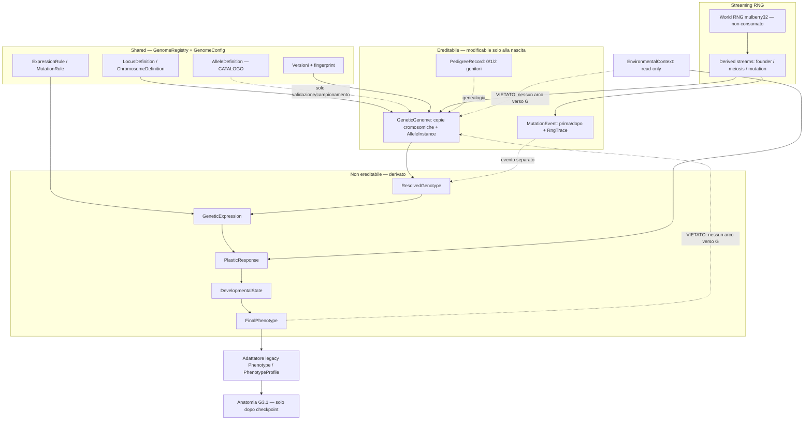

# GENOME — Architettura genetica corretta

**Data:** 2026-11-20  
**Branch:** `milestone/genome/gen0-audit` — PR #4  
**Baseline GEN-0:** commit `2234eec6bb18e0ff5822247346a90461001737fd`  
**Revisione:** Rev 1, conseguente alla revisione tecnica di PR #4.  
**Stato:** proposta architetturale **in attesa di nuova review**. Checkpoint §13 **NON APPROVATO**. Nessuna modifica al codice di produzione, a G3.1, a persistence o alla simulazione core.

---

## 0. Correzioni affrontate in questa revisione

| Rilievo | Correzione | Sezione |
|---|---|---|
| 1. Modello genetico | Separati `LocusDefinition`, `AlleleDefinition`, `Chromosome` (copia singola), `GeneticGenome`, `GenomeRegistry`; posizione loci e dati di ricombinazione espliciti | §2 |
| 2. Espressione | Dominanza non più valore globale per locus: pipeline componibile di regole distinte dalle definizioni alleliche | §3 |
| 3. Pedigree | Fondatori, riproduzione sessuata/asessuata, genealogie parziali; nessun obbligo di due genitori | §4 |
| 4. Mutazioni | Evento completo e separato da effetti fenotipici/fitness; traccia RNG per replay | §5 |
| 5. Separazione dei livelli | Sette contratti distinti; ambiente non può scrivere il genotipo | §6–§7 |
| 6. Contratti mancanti | `GenomeConfig`, `Environment`, `RNG`, serializzazione, migrazione, versionamento, registry vs organismo | §9 + `GENOME_API_CONTRACTS.md` |
| 7. Documentazione | Aggiornati tutti i 5 documenti richiesti; corretti stato commit e baseline | tutti |
| 8. Test progettuali | 13 categorie di test, campioni grandi e multi-seed | `GENOME_VALIDATION_PLAN.md` §6 |
| 9. Vincoli | Nessun codice di produzione toccato; nessun merge; nessuna integrazione Planet Engine | §13 |

---

## 1. Principi architetturali

1. **Definizioni ≠ istanze.** Il catalogo condiviso (`GenomeRegistry`) contiene solo definizioni. L'individuo contiene solo riferimenti a quelle definizioni più il proprio stato. Un catalogo di alleli disponibili **non è mai** il genotipo di un organismo.
2. **Una copia cromosomica per oggetto.** `Chromosome` è una singola copia fisica: in un diploide esistono due oggetti `Chromosome` distinti per ogni gruppo omologo, ciascuno con il proprio allele per locus.
3. **Genotipo ereditabile immutabile.** `GeneticGenome` può essere creato solo da fondazione, ereditarietà o mutazione germinale. Nessuna funzione di ambiente, espressione, sviluppo o rendering può restituirlo o modificarlo.
4. **Flusso unidirezionale.** Genotipo → risoluzione → espressione → regolazione ambientale → plasticità → sviluppo → fenotipo finale. Nessun ritorno al genotipo.
5. **Regole separate dai dati.** Le definizioni degli alleli descrivono *cosa* un allele porta; le regole di espressione descrivono *come* viene combinato. La dominanza è una regola componibile, non un campo singleton del locus.
6. **Tracciabilità completa.** Ogni mutazione è un evento con stato prima/dopo, posizione, origine, organismo, tick e traccia RNG. Effetti e fitness sono eventi/valutazioni separate.
7. **Determinismo per streaming derivato.** Nuovi consumatori casuali usano stream derivati con namespace e salt registrati; il RNG del mondo non viene consumato da operazioni genetiche interne.
8. **Nessuna inferenza biologica non autorizzata.** Strutture senza locus restano `undetermined` / `speculative`; selezione vs deriva resta `NON_EVALUABLE` per i protocolli E2.
9. **Checkpoint prima dei contratti condivisi.** Qualsiasi modifica a `types/index.ts`, persistence, simulazione core o renderer richiede approvazione esplicita (§13).

---

## 2. Modello genetico corretto

### 2.1 Separazione dei concetti

| Concetto | Che cos'è | Dove vive | Invariante |
|---|---|---|---|
| `LocusDefinition` | Definizione stabile di un locus: id, cromosoma, posizione fisica e genetica, catalogo degli alleli ammessi, regole di espressione applicabili | `GenomeRegistry` | ID immutabile; posizione e dati di ricombinazione obbligatori |
| `AlleleDefinition` | Definizione di un allele e delle sue proprietà: profilo di effetto, attività basale, target regolativi, provenienza del catalogo | `GenomeRegistry` | È una definizione, **non** una occorrenza in un individuo |
| `ChromosomeDefinition` | Definizione di un tipo cromosomico: gruppo omologo, lunghezza, centromero, tasso di ricombinazione, ordine dei loci | `GenomeRegistry` | Identifica il *tipo*, non la copia dell'individuo |
| `Chromosome` | **Singola copia cromosomica dell'individuo**: copyId, definizione di appartenenza, gruppo omologo, origine parentale, sequenza ordinata di `LocusCall` | `GeneticGenome` | Per un diploide esistono 2 copie per gruppo omologo |
| `AlleleInstance` | Occorrenza di un allele in una copia: alleleId o `unknown`/`absent`, provenienza individuale, eventi di mutazione che l'hanno prodotta | `Chromosome` | Un solo allele per locus per copia |
| `GeneticGenome` | Composizione genetica effettiva dell'organismo: ploidia, copie cromosomiche, versioni, fingerprint | Organismo | Nessun riferimento al catalogo degli alleli come genotipo |
| `GenomeRegistry` | Catalogo condiviso e versionato di definizioni e regole | Sessione/modulo | Non contiene dati individuali |

### 2.2 Diploidia e coppie omologhe

Un individuo diploide (`ploidy = 2`) possiede **due oggetti `Chromosome` distinti** per ogni `homologousGroup`. Esempio concettuale per il locus `MOR-01` sul gruppo `G1`:

```text
copia "mat"  → LocusCall(MOR-01, posBp, AlleleInstance("MOR-01:A", known, inherited))
copia "pat"  → LocusCall(MOR-01, posBp, AlleleInstance("MOR-01:B", known, mutation→evt-42))
```

È quindi sempre possibile rispondere: *quale allele è presente nella copia 1 e quale nella copia 2 a questo locus?*

- `parentOrigin` distingue `"maternal" | "paternal" | "asexual" | "unknown"`.
- Per ploidia `n > 2` il meccanismo non cambia: esistono `n` copie dello stesso gruppo omologo. Nessun branch speciale nel core.
- `AllelePresence = "known" | "unknown" | "absent"` permette genotipi parzialmente conosciuti senza inventare alleli.
- Un validatore `validateGeneticGenome(genome, registry)` rigetta: copie mancanti, copie duplicate per gruppo, locus duplicati nella stessa copia, alleleId non presente nel registry con `presence = "known"`.

### 2.3 Posizione dei loci e informazioni per la ricombinazione

Ogni `LocusDefinition` dichiara esplicitamente:

- `chromosomeId` e `positionBp` (posizione fisica sulla copia);
- `positionCm` (posizione genetica sulla mappa);
- `strand`;
- `recombination: { crossoverAllowed, interference, hotspot }`;
- appartenenza a `ChromosomeDefinition.locusOrder` (ordinamento per `positionBp`).

`ChromosomeDefinition` aggiunge `lengthBp`, `centromereBp` e `recombinationRateCmPerMb`.

Durante la meiosi un `RecombinationPlan` registra per ogni cromosoma:

- `crossoverPositionsBp` ordinati;
- donatore (`copyId`) per ogni intervallo, determinato dalla parità dei crossover;
- `interference` e hotspot usati;
- traccia RNG che ha generato il piano.

Il gamete risultante contiene **una sola copia per gruppo omologo**, con gli alleli selezionati intervallo per intervallo. Non vengono mai create nuove definizioni alleliche durante la ricombinazione: si riutilizzano solo alleli del registry.

### 2.4 Catalogo alleli ≠ genotipo

`LocusDefinition.alleleCatalog` è l'elenco degli alleli *disponibili*. È usato solo per validazione e campionamento dei fondatori. Il genotipo dell'individuo è esclusivamente l'insieme delle `AlleleInstance` dentro le sue copie cromosomiche.

**Regola assoluta:** nessuna funzione può derivare `GeneticGenome` da `registry.alleles`. Qualsiasi implementazione che lo faccia è un difetto architetturale (rischio R-20).

---

## 3. Sistema di espressione componibile

### 3.1 Definizioni separate dalle regole

`AlleleDefinition` espone solo proprietà:

- `effectProfile: Record<TraitChannelId, number>` — contributo per canale (può toccare più canali ⇒ **pleiotropia**);
- `baselineActivity` (0..1) — livello di attività trascrizionale;
- `regulatoryTargets` — loci regolati;
- `interactionTags` — etichette usate dalle regole di interazione.

Le regole vivono nel registry come `ExpressionRule` distinte:

| Regola | Effetto |
|---|---|
| `complete-dominance` | L'allele in cima alla gerarchia determina il canale |
| `incomplete-dominance` | Media pesata secondo la gerarchia, con pesi configurabili |
| `codominance` | Entrambi gli alleli contribuiscono separatamente, senza gerarchia |
| `allelic-dosage` | Il contributo è proporzionale al numero di copie dell'allele |
| `polygenic-aggregate` | Più loci confluiscono in uno stesso canale con pesi espliciti |
| `pleiotropic-projection` | Un locus proietta il proprio effetto su più canali |
| `epistatic-interaction` | Un locus modificatore sopprime/enhance/maschera un locus target |
| `regulatory-modulation` | Un locus regolatore modula l'attività di uno o più target |
| `gene-gene-interaction` | Interazione generica tra insiemi di loci, con operatore dichiarato |

La dominanza **non** è un singolo valore globale per locus: ogni locus dichiara una lista ordinata di `expressionRuleIds`, e ogni regola ha i propri parametri (gerarchia, pesi, operatore, soglie). Due loci con lo stesso allele possono avere comportamenti diversi se usano regole diverse.

### 3.2 Pipeline di risoluzione

```text
GeneticGenome + GenomeRegistry
  → 1. resolveAlleles        → ResolvedGenotype (chiamate per copia + dosage)
  → 2. applyDominanceRules   → contributi allelici per locus
  → 3. applyEpistasis        → modifiche inter-locus
  → 4. applyPolygenic        → aggregazione per canale (include pleiotropia)
  → 5. applyRegulation       → modulazione dei target regolativi
  → 6. applyGeneInteractions → interazioni residue
  → GeneticExpression (potenziale genetico, senza ambiente)
```

L'ordine è dichiarato in `GenomeConfig.expressionPipeline` e deve essere deterministico. Regole diverse sono combinabili senza modificare `AlleleDefinition`.

---

## 4. Pedigree corretto

`PedigreeRecord` non impone due genitori:

| Situazione | `parents` | `mode` | Note |
|---|---|---|---|
| Fondatore | `[]` | `"unknown"` | `founder = true`, `unknownReason = "founder"` |
| Riproduzione sessuata completa | 2 `ParentLink` con id noti | `"sexual"` | ruoli e gameti registrati |
| Riproduzione sessuata parziale | 1 noto + 1 con `organismId: null` | `"sexual"` | `confidence = "partial"`, motivo dichiarato |
| Riproduzione asessuata | 1 `ParentLink` | `"asexual"` | `role = "sole-parent"` |
| Snapshot legacy | 0 o 1 link | `"unknown"` | `unknownReason = "legacy-snapshot"` |

- `ParentLink` ha `organismId: number | null`, `role`, `confidence` e opzionalmente `gameteId`.
- Nessun ciclo: un organismo non può essere proprio antenato.
- Coefficienti di inbreeding ed eterozigosità sono calcolati **solo** sui link noti; se un ramo è sconosciuto, il risultato per quell'individuo è `NON_EVALUABLE`, non un valore predefinito.
- `SpeciesRecord.parentSpeciesId` resta invariato: il pedigree individuale è una struttura separata.

---

## 5. Tracciabilità delle mutazioni

### 5.1 Evento mutazionale

`MutationEvent` contiene:

- `id`, `tick`, `type`, `origin`;
- `organismId`, `generation` (nullable per fondatori), `chromosomeCopyId`;
- `locusId`, `positionBp`;
- `previousAlleleId` + `previousPresence`;
- `resultingAlleleId` + `resultingPresence`;
- `registryVersion`, `engineVersion`;
- `causedBy` (eventi precursori);
- `rng: RngTrace` con algoritmo, seed, namespace, salt, `stateBefore`, `stateAfter`, `drawCount`;
- `replay: { operation, parametersHash }`.

Con questi campi è possibile ricostruire la modifica effettiva e ripeterla con lo stesso RNG e lo stesso registry.

### 5.2 Separazione degli effetti

| Struttura | Contenuto | Classificazione |
|---|---|---|
| `MutationEvent` | Solo provenance e diff genetico | `OBSERVED` |
| `ExpressionDelta` | Variazioni dei canali fenotipici calcolate confrontando prima/dopo | `DERIVED` |
| `FitnessAssessment` | `status = "NON_EVALUABLE"`, motivo `external-controls-required` | `NON_EVALUABLE` |

`MutationEvent` **non** contiene campi di fitness né effetti fenotipici. Nessuna funzione di fitness può dipendere da `isMutation`: una mutazione non è vantaggiosa o svantaggiosa *per costruzione* (R-05 / test G3-N1).

---

## 6. I sette contratti distinti

| # | Contratto | Ruolo | Può scrivere il genotipo? | Mutabilità |
|---|---|---|---|---|
| 1 | `GeneticGenome` | Genotipo ereditabile | — (è la sorgente) | `readonly`; cambi solo a nascita/mutazione |
| 2 | `ResolvedGenotype` | Risoluzione degli alleli per copia | no | derivato, immutabile |
| 3 | `GeneticExpression` | Espressione genetica (potenziale) | no | derivato, immutabile |
| 4 | `EnvironmentalContext` | Regolazione ambientale | **no** | input read-only |
| 5 | `PlasticResponse` | Plasticità fenotipica non ereditaria | no | `heritable: false` |
| 6 | `DevelopmentalState` | Sviluppo ontogenetico | no | `heritable: false` |
| 7 | `FinalPhenotype` | Fenotipo finale | no | derivato, con provenance per canale |

L'ambiente compare solo come parametro di produzione di `PlasticResponse`. Non esiste alcuna firma del tipo `applyEnvironment(genome, env): GeneticGenome`.

---

## 7. Diagramma dei flussi



Il confine tra `GeneticGenome` e il resto del sistema è la garanzia che l'ambiente e lo sviluppo non alterino l'ereditarietà. L'integrazione con G3.1 resta un checkout separato e non è inclusa in questa revisione.

---

## 8. Matrice delle responsabilità

| Responsabilità | Modulo proposto | Appartenenza | Mutabile da | Serializzato | Test |
|---|---|---|---|---|---|
| Definizioni loci/cromosomi/alleli/regole | `simulation/genome/registry.ts` | Registry condiviso | Solo nuova versione registry | no (solo id+versione) | T-01, T-05…T-08 |
| Configurazione engine | `simulation/genome/config.ts` | Registry/sessione | Solo config versionata | no | T-11, T-12 |
| Genotipo individuale | `simulation/genome/genotype.ts` | Organismo | fondazione/eredità/mutazione | sì | T-01, T-10, T-13 |
| Verifica integrità genotipo | `simulation/genome/validate.ts` | Organismo | — | no | T-01 |
| Ricombinazione e gameti | `simulation/genome/recombination.ts` | Organismo | meiosi | gamete trace | T-03, T-04 |
| Mutazioni e history eventi | `simulation/genome/mutation.ts` | Organismo | mutazione | eventi | T-08 |
| Pedigree | `simulation/genome/pedigree.ts` | Organismo | nascita | sì | T-09, T-10 |
| Risoluzione alleli | `simulation/genome/resolution.ts` | Derivato | — | no | T-01, T-05 |
| Espressione regole | `simulation/genome/expression.ts` | Derivato | — | no | T-05…T-07 |
| Regolazione ambientale | `simulation/genome/environment.ts` | Derivato | — | no | T-11 |
| Sviluppo | `simulation/genome/development.ts` | Derivato | — | no | G5-F1…F3 |
| Serializzazione/migrazione | `simulation/genome/serialization.ts`, `migration.ts` | Infrastruttura | — | sì | T-12, T-13 |
| RNG derivato e tracce | `simulation/genome/rng.ts` | Sessione | — | tracce | T-08, T-11 |

---

## 9. Config, RNG, serializzazione, migrazione, versionamento

Sintesi; le firme complete sono in `GENOME_API_CONTRACTS.md` §3–§7.

- **`GenomeConfig`**: `schemaVersion`, `registryId`/`registryVersion`, `ploidy`, gruppi omologhi, strategia fondatori, tassi di mutazione per tipo, parametri di ricombinazione (crossovers, interferenza, hotspot), soglia di compatibilità, namespace RNG, politica per alleli mancanti, ordine della pipeline di espressione.
- **`Environment`**: contesto read-only (tick, bioma, temperatura, acqua, cibo, predazione, affollamento, provenienza dei dati). Non contiene riferimenti a `GeneticGenome`.
- **`RNG`**: `RngSpec` con algoritmo, seed, namespace, salt, stato prima/dopo, conteggio estrazioni, versione engine. Ogni operazione genetica usa uno stream derivato; `RngTrace` è inclusa negli eventi.
- **Serializzazione**: vengono salvati solo id delle definizioni + versioni + occorrenze alleliche + fingerprint. Il registry non viene duplicato per organismo. Round-trip canonico obbligatorio.
- **Migrazione**: monotonica e idempotente; `MigrationResult` espone `status`, `issues`, versioni di partenza/arrivo. Campi mancanti seguono la politica dichiarata, mai default silenzioso in modalità validazione; versioni future ⇒ `NON_EVALUABLE` con errore esplicito.
- **Versionamento**: distinto `schemaVersion` (formato serializzato), `registryVersion` (definizioni), `engineVersion` (regole), `genomeVersion` legacy (= 2). Ogni snapshot dichiara tutte le versioni usate.

### 9.1 Registry vs organismo

| Struttura | Registry | Organismo |
|---|---|---|
| `LocusDefinition`, `ChromosomeDefinition`, `AlleleDefinition` | ✔ | — |
| `ExpressionRule`, `MutationRule`, `GenomeConfig` default | ✔ | — |
| `Chromosome` (copia), `AlleleInstance`, `LocusCall` | — | ✔ |
| `GeneticGenome`, `PedigreeRecord`, `MutationEvent` | — | ✔ |
| `ResolvedGenotype`, `GeneticExpression`, `PlasticResponse`, `DevelopmentalState`, `FinalPhenotype` | — | ✔ (derivati) |
| `EnvironmentalContext`, `WorldSnapshot` | — | sessione |

---

## 10. Integrazione con i sistemi esistenti (vincoli invariati)

- Il vettore legacy a 33 geni resta il contratto pubblico e la modalità di compatibilità.
- `inheritGenome` / `inheritExt` restano il fallback legacy: la media dei genomi parentali **non** è ereditarietà mendeliana.
- `RenderFrame`, MOR, cache, dynamic pool, fallback e adaptive rendering G3.1 non vengono toccati in questa revisione.
- `World.toSnapshot()` / `fromSnapshot()` e `genomeMigration.ts` restano invariati: nuovi campi solo opzionali.
- Innesto futuro minimo per il body plan: `runtimeAnatomyRenderSource.ts:270-284` (già documentato nella Rev 0), solo dopo checkpoint approvato.
- Nessuna integrazione con Planet Engine in questa fase.

---

## 11. Fasi e gate (aggiornate)

| Fase | Contenuto | Gate |
|---|---|---|
| Rev 0/1 GEN-0 | Audit + revisione architetturale documentale | **in attesa di review** |
| pre-GEN-2 | Esperimento ricalibrazione distanza V2 (R-01), ≥5 seed | risultato documentato |
| GEN-1 | Moduli puri: registry, genotype, validate, recombination, mutation, pedigree, resolution, expression, environment, development, serialization, migration, rng, metrics | solo `simulation/genome/**` + test |
| GEN-2 | Meiosi/fusione e pedigree nel loop live | checkpoint per `reproduction.ts` |
| GEN-3 | Eventi mutazionali completi e separazione effetti | nessun codice fitness |
| GEN-4 | Regole di espressione componibili | checkpoint per `geneExpression.ts` |
| GEN-5 | Sviluppo e plasticità come contratti separati | checkpoint se integrato nel tick |
| GEN-6 | Adattatori verso G3.1 | checkpoint obbligatorio |
| GEN-7/8 | Fisiologia ed evoluzione | checkpoint obbligatorio |

Ogni fase è una PR separata. Nessun merge senza autorizzazione esplicita.

---

## 12. Decisioni ancora aperte

| ID | Decisione | Stato | Impatto |
|---|---|---|---|
| D-01 | Gerarchia di dominanza: ordinamento nel `DominanceRule` vs proprietà sull'allelo | **APERTA** | T-05, T-06 |
| D-02 | Ploidia > 2: mappazione delle copie omologhe e dosage | **APERTA** | T-01, T-02 |
| D-03 | `ext` come vista derivata vs seconda fonte di verità | **APERTA** | compatibilità legacy |
| D-04 | Distribuzione del numero di crossover e modello di interferenza | **APERTA** | T-03, T-04 |
| D-05 | Nuovi alleli come ID di catalogo vs modifiche numeriche di effetto | **APERTA** | T-08, registry |
| D-06 | Politica di pinning della `registryVersion` negli snapshot | **APERTA** | T-12, T-13 |
| D-07 | Metrica di compatibilità: V2 ricalibrata vs distanza su loci | **APERTA** | R-01 |
| D-08 | Rappresentazione di genotipo sconosciuto/parziale nei vecchi snapshot | **APERTA** | T-12 |
| D-09 | Distinzione mutazione germinale/somatica in una simulazione semplificata | **APERTA** | T-08 |
| D-10 | Attribuzione fitness: `NON_EVALUABLE` per default, controlli esterni dedicati | **APERTA** | R-12, G8-S4 |
| D-11 | Budget di memoria per genoma individuale a 10k organismi | **APERTA** | R-09 |
| D-12 | `plantGenome.ts` entra nel registry in questa milestone? | **APERTA** | fuori perimetro GEN-1 |
| D-13 | Approvazione del checkpoint prima di toccare contratti condivisi | **APERTA** | gate §13 |

Nessuna di queste decisioni è stata risolta in questa revisione: non sono state scritte implementazioni.

---

## 13. Checkpoint di architettura

Prima di qualsiasi modifica a:

- `types/index.ts` (contratti condivisi);
- `simulation/core/world.ts` o `reproduction.ts` (simulazione core);
- persistence (`world.ts` snapshot, `genomeMigration.ts`);
- `lib/anatomy/**`, `lib/phenotype/**`, `lib/adaptiveRender.ts`, `components/simulation/planet3d/**`, `lib/visual/**` (G3.1);
- `RenderFrame` o `WorldSnapshot`;

è necessario:

1. aggiornare questo documento con l'impatto esatto (file, funzioni, test coinvolti);
2. ottenere approvazione esplicita della nuova review;
3. aprire una PR dedicata sul branch `milestone/genome/*`;
4. eseguire e allegare `tsc`, test mirati, E2/G3, build e confronto con il baseline quiescente.

**Stato corrente: CHECKPOINT NON APPROVATO.**

Conferma esplicita: in questa revisione **nessun file di codice di produzione è stato modificato**, nessuna modifica a G3.1, persistence, simulazione core o Planet Engine; nessun merge eseguito; `main` resta `5672f12296e484a4ba02ba2876e2f5e82d266cb1`.
