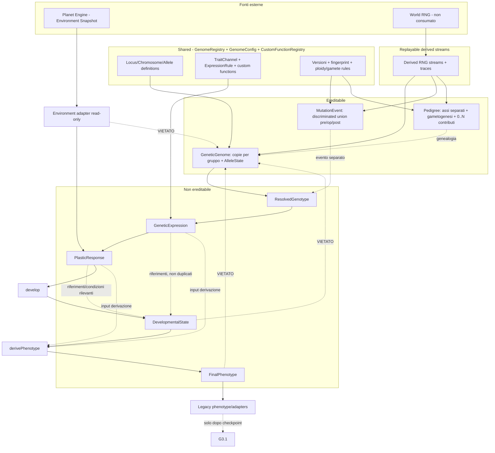

# GENOME — Architettura genetica corretta (Rev 4)

**Data:** 2026-11-20  
**Branch:** `milestone/genome/gen0-audit` — PR #4  
**Baseline GEN-0:** commit `2234eec6bb18e0ff5822247346a90461001737fd` (Rev 0), Rev 1 `2c800cf`, Rev 2 `319d975`, Rev 3 `df9d533a626d1e2b9ff91124b3e8ff2eb77378c8`  
**Revisione:** Rev 4, correzioni architetturali/contrattuali dopo review indipendente della Rev 3 (G1–G5).  
**Stato:** proposta architetturale **in attesa di review indipendente**. Checkpoint §13 **NON APPROVATO**. Nessuna modifica al codice di produzione, a G3.1, a Planet Engine, a persistence, a workers, a `types/index.ts` o alla simulazione core. **GEN-1 non avviato.**

---

## 0. Correzioni Rev 4

| Criticità | Correzione | Sezione |
|---|---|---|
| G1 | `MutationEvent` riprogettato come discriminated union per operazione: point mutation, insertion, deletion, duplication, inversion, translocation, chromosome-level event, aneuploidy, variazione strutturale compatibile. Ogni variante rappresenta struttura precedente, operazione, struttura risultante, cromosomi/intervalli/copie coinvolti, materiale genetico inserito/rimosso/duplicato, posizione/orientamento risultanti, provenienza/causalità. `affectedLoci` non richiesto per eventi esclusivamente intergenici o a intero cromosoma. Combinazioni scope/operation/payload impossibili impedite dal tipo. Nessun limite arbitrario a loci/complessità. | §5.1 |
| G2 | Pipeline corretta: `GeneticGenome → ResolvedGenotype → GeneticExpression → PlasticResponse → DevelopmentalState → FinalPhenotype`. `develop()` restituisce `DevelopmentalState` (non `FinalPhenotype`). Passaggio distinto e verificabile `derivePhenotype()` produce `FinalPhenotype`. `DevelopmentalState` senza duplicazioni di dati già presenti in `GeneticExpression`/`PlasticResponse`. | §6, §7 |
| G3 | Regole esplicite di formazione gameti: distinti ploidia organismo, ploidia gamete, numero contributori, modalità riproduttiva, regole di segregazione, anomalie meiotiche. Nessuna assunzione che ogni gamete contenga sempre una sola copia per gruppo omologo. Architettura estendibile a modelli poliploidi senza compromettere correttezza del modello diploide iniziale. | §4.1, §4.2 |
| G4 | Formalizzate combinazioni ammissibili tra scope, operation, payload, cromosomi, loci, intervalli; invarianti verificabili e comportamenti di errore definiti. | §5.2 |
| G5 | Registry funzioni custom completo: identificativo stabile, versione, firma input/output, unità/domini, implementazione registrata, determinismo, gestione funzioni mancanti, compatibilità replay/serializzazione. L'identificativo non è sufficiente senza implementazione disponibile e compatibile. | §3.4 |

---

## 1. Principi architetturali

1. **Definizioni ≠ istanze.** `GenomeRegistry` contiene solo definizioni condivise e registri versionati (incluso registry funzioni custom); l'individuo contiene solo occorrenze/stati e riferimenti versionati.
2. **Una copia cromosomica per oggetto.** `Chromosome` è una singola copia fisica; il numero di copie è determinato per gruppo omologo dal `PloidyModel` dell'organismo.
3. **Stato allelico esplicito.** Assenza biologica, dato non disponibile e dato non valutabile sono stati distinti e non intercambiabili; vietato `null` ambiguo.
4. **Provenienza generalizzata e gametogenesi esplicita.** Ogni copia/contributo è tracciato da `contributionId`/`contributorId`/`gameteId`; identità del contributore separata da ruoli biologici opzionali; ploidia organismo, ploidia gamete, segregazione e anomalie meiotiche sono distinte ed esplicite.
5. **Genotipo ereditabile immutabile.** `GeneticGenome` nasce da fondazione, ereditarietà o mutazione germinale; ambiente, espressione, plasticità, sviluppo e rendering non lo modificano.
6. **Flusso unidirezionale e fasi distinte.** Genotipo → risoluzione → espressione → regolazione ambientale → plasticità → sviluppo → derivazione fenotipo finale. `develop()` produce `DevelopmentalState`; `derivePhenotype()` produce `FinalPhenotype`.
7. **Regole separate dai dati e quantitative.** Canali con unità, domini finiti, normalizzazione e conflitti espliciti; funzioni custom solo se registrate, versionate e deterministiche.
8. **Tracciabilità e replay verificabile.** Eventi/mutazioni registrano struttura precedente, operazione, struttura risultante, provenienza e traccia RNG; replay incompatibile produce errore esplicito, mai risultato valido apparente.
9. **Maturità dichiarata.** Ogni componente è `progettato`, `implementato-non-integrato`, `integrato` o `attivo` con criteri verificabili.
10. **Checkpoint prima dei contratti condivisi.** Nessuna modifica a `types/index.ts`, persistence, workers, simulazione core o renderer prima di approvazione esplicita (§13).

---

## 2. Modello genetico corretto

### 2.1 Separazione dei concetti

| Concetto | Che cos'è | Dove vive | Invariante |
|---|---|---|---|
| `LocusDefinition` | Definizione stabile di un locus | `GenomeRegistry` | ID immutabile; coordinate e parametri dichiarati |
| `AlleleDefinition` | Definizione di allele nel catalogo | `GenomeRegistry` | definizione, non occorrenza |
| `ChromosomeDefinition` | Tipo cromosomico e gruppo omologo | `GenomeRegistry` | tipo, non copia |
| `PloidyModel` | Ploidia per gruppo omologo (organismo) | `GeneticGenome`/config | uniforme o aneuploide; copie coerenti per gruppo |
| `GeneticContribution` | Contributo genetico tracciabile | pedigree/gamete/copia | identità ≠ ruolo biologico |
| `Chromosome` | Singola copia cromosomica | `GeneticGenome` | una copia = un oggetto; `contributionId` |
| `AlleleState` | Stato esplicito dell'allele | `LocusCall`/evento | `identified` / `biologically-absent` / `undetermined` / `non-evaluable` |
| `GeneticGenome` | Composizione genetica effettiva | organismo | solo occorrenze individuali |
| `GenomeRegistry` | Catalogo condiviso versionato | sessione/modulo | nessun dato individuale; include registry funzioni custom |

### 2.2 Ploidia per gruppo omologo, copie e contributori

- `PloidyModel` (organismo) è valutato **per gruppo omologo** (`HomologousGroupId`).
  - **Uniforme:** stesso numero di copie `n >= 1` per ogni gruppo dichiarato; il riepilogo globale `ploidy` è valido solo in questo caso (`globalPloidy = n`).
  - **Aneuploide:** numero di copie distinto per gruppo (`byGroup[group] >= 0` o `>= 1` secondo policy dichiarata); **nessun** riepilogo globale singolo è valido, salvo derivati espliciti per-gruppo non usati come ploidia globale.
- Per ogni gruppo, il genoma contiene esattamente le copie previste dal modello (invariante di cardinalità).
- Ogni `Chromosome` riferisce `homologousGroup`, `copyId` e `contributionId`; il contributo identifica contributore/gamete/confidenza noti o non valutabili.
- Nessun campo fisso `maternal`/`paternal`; eventuali ruoli biologici sono metadati opzionali.
- Il modello rappresenta fondatori, sessuata, asessuata, poliploidia uniforme, aneuploidia, multi-contributore e origine sconosciuta/non valutabile.

### 2.3 Stati allelici

`AlleleState` è una unione discriminata (mai `null` ambiguo):

| Stato | Significato | `alleleId` |
|---|---|---|
| `identified` | Allele presente e identificato | obbligatorio, valido |
| `biologically-absent` | Assenza biologica reale (delezione/locus perso/null-allele strutturale) | vietato |
| `undetermined` | Dato non disponibile/non ancora determinato | vietato |
| `non-evaluable` | Non valutabile nel contesto/versione | vietato |

Impatto: espressione/ereditarietà/mutazione/fenotipo devono propagare o marcare esplicitamente secondo policy dichiarata; `biologically-absent` non è dato mancante.

### 2.4 Posizione dei loci e ricombinazione

- `LocusDefinition`: `chromosomeId`, `positionBp`, `positionCm`, strand, vincoli e parametri.
- `ChromosomeDefinition`: lunghezza, centromero, tasso/ordine, supporto hotspot/interferenza.
- `RecombinationTrace`: deterministico dato input+trace RNG compatibile; registra intervalli, donatori (`copyId`/`contributionId`), crossover e, quando rilevante, esiti di segregazione/anomalia meiotica. I riferimenti a loci sono opzionali quando l'evento/intervallo è esclusivamente intergenico.

### 2.5 Registry e funzioni custom

- `GenomeRegistry` include definizioni di loci/alleli/cromosomi/canali/regole e un **registry di funzioni custom** versionato.
- Ogni funzione custom di espressione/normalizzazione è un artefatto registrato con: identificativo stabile, versione, firma input/output, unità e domini dichiarati, riferimento/identità dell'implementazione registrata, dichiarazione di determinismo e metadati di compatibilità (replay/serializzazione).
- Un identificativo di funzione **non è sufficiente** se l'implementazione non è disponibile, non è compatibile con versione/contesto, o non soddisfa la firma/determinismo dichiarati: il risultato è `non-evaluable` o errore esplicito secondo policy (mai fallback silenzioso).

---

## 3. Sistema di espressione componibile e quantitativo

### 3.1 Separazione definizioni / regole

- `AlleleDefinition`: proprietà/effetti con scala coerente ai canali.
- `ExpressionRule`: combinazione di stati/effetti (dominanza, dosaggio, poligenia, epistasi, pleiotropia, regolazione, interazioni). Nessuna dominanza globale per locus.
- Supporto a numero arbitrario di loci/canali/regole (nessun limite prefissato).

### 3.2 Pipeline deterministica

```text
GeneticGenome + GenomeRegistry + GenomeConfig
  → resolveAlleles      → ResolvedGenotype
  → applyExpressionRules→ contributi per canale
  → validateAndNormalize→ valori finiti, dominio, unità
  → resolveConflicts    → esito deterministico o non-evaluable esplicito
  → GeneticExpression
```

### 3.3 Contratti quantitativi (obbligatori)

- **Validità numerica:** ogni valore numerico di input/output intermedio/finale deve essere finito (`Number.isFinite`), non `NaN`, non `±Infinity`. Valore non valido ⇒ `non-evaluable` o errore secondo `clampPolicy`, mai propagato come valore valido.
- **Unità e semantica:** ogni `TraitChannelDefinition` dichiara `unit` e semantica; input/output devono essere coerenti alla scala dichiarata.
- **Intervalli e vincoli:** `domain.min <= domain.max`; policy esplicita `clamp | error | mark-non-evaluable` per fuori dominio.
- **Normalizzazione:** metodo dichiarato (`linear`, `saturating`, `none`, `custom`). Metodi standard hanno parametri e semantica documentata/versionata dal registry/engine; `custom` è ammesso solo se risolve a una funzione registrata compatibile (vedi §3.4). Uso di `custom` non verificabile ⇒ `non-evaluable`.
- **Pesi:** pesi/regole di aggregazione dichiarati, finiti e con semantica esplicita (es. somma normalizzata o non normalizzata dichiarata); pesi mancanti/invalidi ⇒ `non-evaluable`.
- **Effetti e stati:** `biologically-absent` ⇒ contributo nullo o regola esplicita; `undetermined`/`non-evaluable` propagati secondo `missingInputPolicy` del canale.
- **Conflitti (D-01 circoscritto):** default `priority-order` con priorità esplicite; alternative (`weighted-merge`, `mark-non-evaluable`) richiedono parametri completi e deterministici. Priorità mancanti/ambigue o conflitto irrisolvibile ⇒ `mark-non-evaluable` (nessun tie-break implicito). Sintassi/DSL estesa resta fuori ambito finché non versionata in registry.
- **Catalogo canali/unità (D-07 circoscritto):** catalogo iniziale `TraitChannelDefinition` e unità normalizzate specifiche sono registry/deployment-specifici, non fissati in Rev 4; vincolanti restano i requisiti minimi del contratto (unità dichiarata, dominio finito, normalizzazione dichiarata, policy stati).

### 3.4 Registry delle funzioni custom (G5)

- **Contratto richiesto per ogni funzione custom:** `functionId` stabile, `version`, firma input/output dichiarata, unità e domini input/output, riferimento/identità dell'implementazione registrata, flag/contratto di determinismo, metadati di compatibilità replay/serializzazione.
- **Registrazione e disponibilità:** l'uso in canale/regola è valido solo se la terna (id, versione, contesto) è presente nel registry e l'implementazione è disponibile e compatibile con firma/unità/domini.
- **Determinismo:** la funzione deve essere deterministica rispetto a input e contesto dichiarato; uso di stato esterno/RNG non tracciato è vietato dal contratto (violazione ⇒ errore esplicito o `non-evaluable` secondo policy).
- **Funzione mancante/non compatibile:** nessuna esecuzione implicita. Se id noto ma implementazione/versione/firma/compatibilità non disponibili ⇒ `ValidationError` o esito `non-evaluable` esplicito (policy dichiarata), mai riproduzione basata su fallback silenzioso.
- **Replay e serializzazione:** eventi/snapshot/config serializzano riferimenti versionati; replay richiede stessa risoluzione di funzione/versione/implementazione compatibile, altrimenti `ReplayResult` `incompatible` con mismatch esplicito. Un identificativo di funzione da solo non garantisce riproducibilità.

---

## 4. Pedigree, riproduzione, gametogenesi e contributi

### 4.1 Assi separati

- **Assi separati (non mescolati in un unico enum):**
  - `ReproductionMode`: `sexual | asexual | unknown` (modalità riproduttiva).
  - `PloidyModel` (organismo): ploidia per gruppo omologo dell'organismo (indipendente dalla modalità).
  - `GameteFormationMode`: es. `meiotic | amitotic | apomictic | none | unknown` (modalità di formazione/trasmissione del materiale genetico).
  - **Ploidia del gamete (`GametePloidy`):** numero di copie per gruppo omologo nel gamete, distinto dalla ploidia dell'organismo e determinato/validato dalle regole di formazione.
  - **Regole di segregazione (`SegregationRule`):** modello dichiarato di distribuzione delle copie nei gameti/nei contributi (es. disomica/polisomica o altra regola versionata), con parametri e precondizioni esplicite.
  - **Anomalie meiotiche (`MeioticAnomaly`):** eventi/anomalie dichiarati (es. non-disgiunzione, formazione gameti sbilanciati), opzionali ma rappresentabili e tracciabili.
  - Numero/contributori: `contributors: GeneticContribution[]` con cardinalità 0..N e `contributorSelectionMode` dichiarato quando pertinente.
- **Combinazioni ammesse:** sessuata o asessuata con organismi uniformemente poliploidi o aneuploidi, se `PloidyModel` organismo, `GameteFormationMode`, regole di segregazione e vincoli di ploidia gamete lo supportano; nessuna combinazione implicita.
- `PedigreeRecord`: 0..N contributi, identità separata da ruolo, tracciabilità gamete/contributionId, genealogie parziali (`known/partial/unknown/non-evaluable`). Nessun ciclo; metriche dipendenti da rami ignoti/non valutabili ⇒ `NON_EVALUABLE`.

### 4.2 Formazione dei gameti e poliploidia (G3)

- **Distinzioni obbligatorie:** ploidia organismo ≠ ploidia gamete ≠ numero contributori ≠ modalità riproduttiva ≠ regole di segregazione ≠ anomalie meiotiche.
- **Ploidia gamete:** definita per gruppo omologo nel risultato (`GametePloidy`); può essere ridotta, invariata o altrimenti determinata secondo `GameteFormationMode` e `SegregationRule`. **Non si assume** che ogni gamete contenga sempre una sola copia per gruppo omologo (valido in alcuni casi diploidi standard, non assunto in generale).
- **Segregazione:** ogni formazione di gamete dichiara la regola applicata, i gruppi coinvolti e l'esito per copia/gruppo; in caso di poliploidia la regola deve essere esplicita (nessun default implicito).
- **Anomalie meiotiche:** rappresentabili come esito/regola dichiarata con impatto sulla ploidia/contenuto del gamete e tracciate nel `Gamete`/trace; non possono essere introdotte implicitamente.
- **Estendibilità:** l'architettura deve supportare modelli poliploidi (uniformi/aneuploidi) senza compromettere la correttezza del modello diploide iniziale (che resta un caso particolare con regole esplicite). Le configurazioni non supportate dalla regola/versione dichiarata producono errore esplicito o esito `non-evaluable` secondo policy.

---

## 5. Tracciabilità mutazioni e replay

### 5.1 Mutazioni come discriminated union (G1)

- `MutationEvent` è una **discriminated union** per operazione, con payload tipizzato e vincoli coerenti. Operazioni rappresentate almeno: `point-mutation`, `insertion`, `deletion`, `duplication`, `inversion`, `translocation`, `chromosome-level-event`, `aneuploidy`, `structural-variation` (compatibile con il modello ed estendibile senza limiti arbitrari).
- Ogni variante/evento rappresenta esplicitamente:
  - **struttura precedente** e **struttura risultante** (stati/copie/intervalli/cromosomi coinvolti, secondo l'operazione);
  - **operazione effettuata** (discriminante);
  - **cromosomi e intervalli coinvolti** (`chromosomeIds`, intervalli/coordinate quando applicabili);
  - **identificativi delle copie** coinvolte (`copyIds`/riferimenti copia);
  - **materiale genetico inserito, rimosso o duplicato** quando applicabile (sequenza/loci/stati/segmenti secondo payload);
  - **posizione e orientamento risultanti** quando applicabile;
  - **provenienza e causalità** (`origin`, `causedBy`, contributo, tick, organismo/generazione come disponibili), versioni e `RngTrace`.
- **`affectedLoci`:** richiesto solo quando l'operazione coinvolge loci identificabili; **non imposto** per eventi esclusivamente intergenici o per eventi a intero cromosoma/copia dove i loci non sono l'unità pertinente (in tali casi si usano intervalli/cromosomi/copie).
- **Nessun limite arbitrario:** il modello non impone limiti prefissati al numero di loci, segmenti o complessità cromosomica; le collezioni sono estensibili e vincolate solo da coerenza/invarianti.
- Effetti fenotipici (`ExpressionDelta`) e fitness (`FitnessAssessment`, `NON_EVALUABLE` per default) restano artefatti separati e non fanno parte del payload mutazionale.

### 5.2 Coerenza mutazioni e invarianti (G4)

- **Combinazioni ammissibili** formalizzate tra `scope`, `operation`, payload, cromosomi, loci e intervalli (esempi vincolanti): `point-mutation` ⇒ scope puntuale, nessun intervallo esteso/materiale strutturale duplicato inter-cromosomico; `insertion`/`deletion`/`duplication` ⇒ payload di materiale/intervallo coerente e struttura risultante compatibile; `inversion` ⇒ intervallo e orientamento risultante; `translocation` ⇒ cromosomi/copie/intervalli sorgente-destinazione e posizione/orientamento risultanti; `chromosome-level-event`/`aneuploidy` ⇒ copie/cromosomi come unità primaria, loci non obbligatori se non pertinenti; `structural-variation` ⇒ payload esplicito compatibile con scope dichiarato.
- **Invarianti verificabili (esempi):** discriminante coerente con payload; riferimenti (cromosomi/copie/loci/intervalli) esistenti e compatibili con `PloidyModel`/registry versionati; intervalli con estremi validi e ordinati; struttura precedente ≠ risultante dove l'operazione lo richiede; materiale inserito/rimosso/duplicato coerente con operazione; `affectedLoci` assente solo nei casi consentiti; replay/RNG/versioni presenti.
- **Comportamenti di errore:** combinazione non ammissibile o payload incoerente ⇒ validazione fallita (`ValidationError`/`invalid`), nessuna applicazione parziale implicita. Evento non riproducibile/compatibile ⇒ `ReplayResult` `incompatible` con mismatch espliciti (vedi §5.3). Nessuna correzione o completamento silenzioso di payload mancante.

### 5.3 Replay deterministico

- `ReplayResult<T>` union discriminata:
  - `status: "ok"` ⇒ `value: T` non nullo, `mismatches: []`.
  - `status: "incompatible"` ⇒ `value: null`, `mismatches` espliciti e non vuoti (campo, atteso, osservato).
- Compatibilità verificata su: algoritmo/versione RNG, parametri/hash evento, registry id/version/fingerprint (incluso registry funzioni custom quando pertinente), engine version, schema version e contesto richiesto.
- Incompatibilità ⇒ nessun fallback silenzioso, nessun replay eseguito come valido, nessun risultato valido apparente.

---

## 6. Contratti distinti e ambiente

| # | Contratto | Ruolo | Scrive genotipo? | Ereditabile? |
|---|---|---|---|---|
| 1 | `GeneticGenome` | Genotipo ereditabile | sorgente | sì |
| 2 | `ResolvedGenotype` | Risoluzione stati/dosaggi | no | no |
| 3 | `GeneticExpression` | Potenziale genetico quantitativo | no | no |
| 4 | `EnvironmentalSnapshot` | Contesto ambientale da Planet Engine | no | no |
| 5 | `PlasticResponse` | Risposta non ereditaria (delta/regolazione rispetto all'espressione) | no | no |
| 6 | `DevelopmentalState` | Stato ontogenetico (risultato di `develop()`) | no | no |
| 7 | `FinalPhenotype` | Fenotipo finale derivato (risultato di `derivePhenotype()`) | no | no |

### 6.1 Pipeline e separazione delle fasi (G2)

```text
GeneticGenome
  → resolveAlleles       → ResolvedGenotype
  → express              → GeneticExpression
  → regulate (env)       → PlasticResponse
  → develop              → DevelopmentalState   (non FinalPhenotype)
  → derivePhenotype → FinalPhenotype
```

- **`develop()`** restituisce esclusivamente `DevelopmentalState`.
- **`derivePhenotype()`** è un passaggio distinto e verificabile che produce `FinalPhenotype` a partire da stato di sviluppo e riferimenti/contesto necessari (senza collassare le fasi).
- Ogni passaggio è deterministico dato input e contesto compatibili/versionati.

### 6.2 DevelopmentalState (senza duplicazioni)

- `DevelopmentalState` rappresenta in modo coerente: **età e tempo biologico** (valori + unità/riferimento), **stadio di sviluppo**, **crescita e maturazione**, **stato dei processi di sviluppo**, ed **eventuali condizioni ambientali/plastiche rilevanti** al processo di sviluppo.
- **Nessuna duplicazione:** non replica canali/valori già presenti in `GeneticExpression` né delta/canali già presenti in `PlasticResponse`; fa riferimento a tali artefatti tramite identificativi/fingerprint/tick coerenti e registra solo stato/processi/condizioni specifiche dello sviluppo e riferimenti necessari alla derivazione finale.
- Dati non valutabili nello sviluppo sono rappresentati esplicitamente (`status: "undetermined" | "non-evaluable"` con motivo) e non sostituiti da valori validi.
- Stadi (`stage`) sono valori dichiarati/versionati dal modello di sviluppo; transizioni non implicite.
- Sviluppo e plasticità sono sempre non ereditabili.

### 6.3 Fonte ambientale (Planet Engine)

- Fonte autorevole unica: **Environment Snapshot del Planet Engine** (contratto di integrazione/versionato).
- GENOME non crea né mantiene un modello ambientale parallelo: può solo leggere/normalizzare tramite adattatore documentato.
- Contratto richiesto: identificativi producer/snapshot/contract, riferimento temporale e coerenza temporale (istantanea o intervallo dichiarato), coordinate/riferimento spaziale e modalità di campionamento locale/granularità, campi con unità, provenienza e stato uniforme.
- **Stati campo ambientale uniformati:** ogni campo espone `status: "value" | "missing" | "non-evaluable"`, `provenance: "OBSERVED" | "DERIVED"` (quando applicabile), `value`/`unit`/`reason` coerenti; `missing` ≠ `non-evaluable`.
- Mapping concreto campo-per-campo subordinato al contratto Planet Engine (D-14).

---

## 7. Diagramma dei flussi



---

## 8. Matrice delle responsabilità

| Responsabilità | Modulo proposto | Appartenenza | Mutabile da | Serializzato | Maturità attuale |
|---|---|---|---|---|---|
| Definizioni registry/canali/regole/funzioni custom | `simulation/genome/registry.ts` | Registry | nuova versione | id+versioni+fingerprint | **progettato** |
| Config, ploidia organismo/gamete, segregazione, versioni | `simulation/genome/config.ts` | Registry/sessione | config versionata | id+versioni | **progettato** |
| Genotipo e stati allelici | `simulation/genome/genotype.ts` | Organismo | fondazione/ereditarietà/mutazione | sì | **progettato** |
| Validazione numerica/contratti/invarianti mutazione | `simulation/genome/validate.ts` | Infrastruttura | — | no | **progettato** |
| Contributi, gameti, segregazione, ricombinazione | `simulation/genome/recombination.ts`, `pedigree.ts` | Organismo | nascita/trasmissione | sì (trace) | **progettato** |
| Mutazioni (union discriminata) e replay | `simulation/genome/mutation.ts`, `rng.ts` | Organismo/sessione | mutazione/evento | eventi+trace | **progettato** |
| Risoluzione/espressione quantitativa/custom functions | `simulation/genome/resolution.ts`, `expression.ts` | Derivato | — | no | **progettato** |
| Adattamento ambiente Planet Engine | `simulation/genome/environment.ts` | Derivato/adattatore | — | no | **progettato** |
| Sviluppo e derivazione fenotipo finale | `simulation/genome/development.ts` | Derivato | — | no | **progettato** |
| Serializzazione/migrazione | `simulation/genome/serialization.ts`, `migration.ts` | Infrastruttura | — | sì | **progettato** |
| Integrazione live simulazione | `simulation/core/*`, `reproduction.ts` | Core | PR future con checkpoint | n/a | **non avviata** |

Nessun modulo GENOME è implementato, integrato o attivo nel codice di produzione in Rev 4.

---

## 9. Config, RNG, ambiente, serializzazione, versionamento

### 9.1 GenomeConfig, ploidia e gametogenesi

- `GenomeConfig` dichiara: versioni, registry (incluso registry funzioni custom), `PloidyModel` organismo/gruppi, strategia fondatori, regole mutazione/ricombinazione, `GameteFormationMode`, regole di segregazione (`SegregationRule`), politiche di ploidia gamete e anomalie meiotiche supportate, canali, pipeline, policy stati mancanti/non valutabili, compatibilità, RNG, riferimento contratto Planet Engine.
- **Invarianti ploidia organismo:** per ogni gruppo, copie presenti = valore previsto da `PloidyModel`; riepilogo globale solo se uniforme; aneuploidia esplicita senza globale implicito.
- **Invarianti gamete:** ploidia gamete per gruppo dichiarata/validata dalla regola di segregazione e formazione; non assunta costante a 1 copia per gruppo; esiti/anomalie coerenti con regola e tracciati.
- Versioni/fingerprint obbligatori: `schemaVersion`, `registryVersion`, `engineVersion`, `rngAlgorithmVersion` (se applicabile), `planetEnvironmentContractVersion`, versioni/fingerprint registry funzioni custom quando pertinenti.

### 9.2 RNG e replay deterministico

- Stream derivati dal world RNG con namespace/salt dichiarati; world RNG non consumato dal replay interno.
- `RngTrace` include algoritmo, versione, seed/root, namespace, salt, stato prima/dopo, draw count, engine version.
- Compatibilità richiesta su algoritmo/versione RNG, parametri/hash, registry fingerprint/version (incluso custom functions registry), engine/schema/contesto.
- `ReplayResult<T>`: `ok` con valore non nullo e `mismatches: []`; `incompatible` con `value: null` e mismatch espliciti non vuoti; nessun risultato valido apparente.

### 9.3 EnvironmentalSnapshot (Planet Engine)

- Identificazione: `source: "planet-engine"`, producer, contract/snapshot version.
- **Coerenza temporale:** `tick`/riferimento e modalità (`instant` o intervallo con inizio/fine) dichiarata.
- **Coordinate e campionamento locale:** sistema di coordinate, riferimento spaziale, granularità, metodo di campionamento (es. cella/punto/raggio/area) e parametri necessari.
- **Campi:** unità, `provenance` (`OBSERVED|DERIVED`), `status` (`value|missing|non-evaluable`), valore finito quando `value`, motivo quando non valorizzabile.
- Adattatore read-only; mapping concreto subordinato al contratto Planet Engine (D-14).

### 9.4 Serializzazione e migrazione

- Serializzare solo id/versioni/fingerprint + occorrenze individuali, incluse copie per gruppo, `AlleleState`, contributi, payload mutazionali strutturati (struttura pre/op/post, intervalli/copie/materiale/posizione-orientamento quando applicabili) e riferimenti versionati a funzioni custom.
- Migrazione monotonica e idempotente; versioni non supportate ⇒ `unsupported`/`NON_EVALUABLE` esplicito.
- `biologically-absent`, `undetermined`, `non-evaluable`, stati campo ambientali e casi intergenici/cromosomici senza `affectedLoci` preservati senza collasso semantico.
- Funzione custom referenziata ma non disponibile/compatibile in fase di replay/deserializzazione contestuale ⇒ esito incompatibile/non-evaluable esplicito secondo contratto (mai fallback silenzioso).

---

## 10. Maturità, fasi e criteri verificabili

| Livello | Definizione | Criteri verificabili |
|---|---|---|
| **Progettato** | Definito in documentazione/contratti | tipi/invarianti/flussi/test plan presenti; nessun codice operativo dichiarato |
| **Implementato (non integrato)** | Predisposizione/scaffolding isolato | modulo presente, API conforme, test unitari verdi, nessun call-site live |
| **Integrato** | Collegato ma non necessariamente attivo | wiring/flag documentati, test integrazione verdi, default legacy invariato se disattivato |
| **Attivo/Operativo** | Effettivo nel percorso live previsto | abilitazione supportata, end-to-end/regressione/osservabilità, baseline confrontata |

**Stato attuale (Rev 4):** tutti i componenti Genome Engine sono **progettati**. Nessun modulo è implementato, integrato o attivo. GEN-1/2/3 non rappresentano funzionalità operative.

| Fase | Natura | Significato |
|---|---|---|
| GEN-0 Rev 4 | documentale | correzioni G1–G5 e coerenza contrattuale per nuova review indipendente |
| GEN-1 (futura) | predisposizione isolata | scaffolding/test isolati; **non** meiosi/mutazione/pedigree operativi |
| GEN-2 (futura) | integrazione/attivazione | ereditarietà/pedigree/gametogenesi controllati, dopo checkpoint e PR dedicata |
| GEN-3 (futura) | integrazione/attivazione | mutazioni nel flusso previsto, replay e effetti separati |

---

## 11. Integrazione con sistemi esistenti

- Vettore legacy 33 geni, fallback blending, G3.1, persistence, workers e core restano invariati.
- Nessuna integrazione con Planet Engine implementata: solo contratto di riferimento/adattatore progettato.
- Compatibilità con renderer G3.1 preservata senza riscrittura; innesti futuri (es. `runtimeAnatomyRenderSource.ts:270-284`) solo dopo checkpoint §13.

---

## 12. Decisioni ancora aperte

| ID | Decisione | Stato | Nota Rev 4 |
|---|---|---|---|
| D-01 | DSL/sintassi avanzata di conflitti oltre strategia default | **APERTA (circoscritta)** | default `priority-order` + `mark-non-evaluable` su ambiguità definito; estensioni versionate future |
| D-02 | Dettagli mappatura copie/contributi in casi di ploidia/aneuploidia complessa | **APERTA** | invarianti per-gruppo, ploidia gamete e segregazione esplicite; mapping operativo specifico da dettagliare |
| D-03 | Fallback dichiarato specifico per canali con input mancanti/non valutabili | **APERTA** | policy e stati definiti; valori/funzioni fallback per canale restano registry-specifici |
| D-04 | Rappresentazione di assenze strutturali complesse multi-allele | **APERTA** | `biologically-absent` e mutazioni strutturali definite; codifica casi complessi da dettagliare |
| D-05 | Generazione nuovi stati/alleli da mutazione strutturale | **APERTA** | evento deve registrare struttura precedente/risultante; strategia generativa da definire |
| D-06 | Pinning registry/config/environment/custom-function registry negli snapshot | **APERTA** | fingerprint/versioni richieste; meccanismo di pinning operativo da definire |
| D-07 | Catalogo iniziale `TraitChannelDefinition` e unità normalizzate specifiche | **APERTA (circoscritta)** | requisiti minimi/unità dichiarata vincolanti; catalogo concreto registry-specifico |
| D-08 | Metrica compatibilità post R-01 | **APERTA** | non bloccante per Rev 4 |
| D-09 | Distinzione germinale/somatica nel modello di simulazione | **APERTA** | `MutationOrigin` già distinto |
| D-10 | Budget memoria/costo per N elevato | **APERTA** | richiede misure |
| D-11 | Serializzazione replay trace/payload mutazionali voluminosi | **APERTA** | campi minimi definiti; payload strutturati richiesti |
| D-12 | Coinvolgimento di `plantGenome.ts` | **APERTA** | fuori perimetro |
| D-13 | Approvazione checkpoint §13 | **APERTA** | prerequisito per modifiche shared |
| D-14 | Mapping concreto verso Environment Snapshot del Planet Engine | **APERTA** | subordinato al contratto Planet Engine; requisiti minimi definiti |

---

## 13. Checkpoint di architettura

Prima di qualsiasi modifica a `types/index.ts`, `simulation/core/world.ts`, `reproduction.ts`, persistence, workers, `lib/anatomy/**`, `lib/phenotype/**`, renderer, `RenderFrame` o `WorldSnapshot` è necessario:

1. aggiornare questo documento con impatto esatto;
2. ottenere approvazione esplicita della review indipendente;
3. aprire PR dedicata su `milestone/genome/*`;
4. eseguire e allegare `tsc`, test mirati, E2/G3, build e confronto con baseline quiescente.

**Stato corrente: CHECKPOINT NON APPROVATO.**

**Conferma esplicita Rev 4:** nessun file di codice di produzione modificato; nessuna modifica a G3.1, Planet Engine, persistence, workers, simulazione core o shared core; nessuna integrazione; **GEN-1 non avviato**; nessun merge; `main` resta `5672f12296e484a4ba02ba2876e2f5e82d266cb1`. GEN-0 non è dichiarato approvato (decisione finale della review indipendente).
