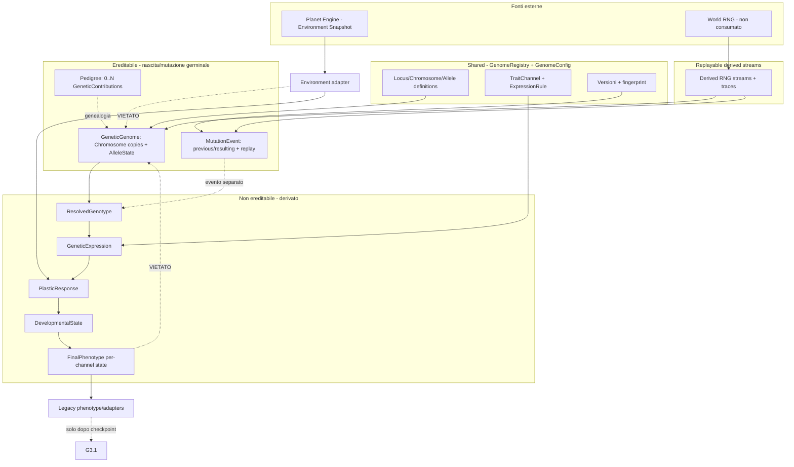

# GENOME — Architettura genetica corretta (Rev 2)

**Data:** 2026-11-20  
**Branch:** `milestone/genome/gen0-audit` — PR #4  
**Baseline GEN-0:** commit `2234eec6bb18e0ff5822247346a90461001737fd` (Rev 0)  
**Revisione:** Rev 2, correzioni architetturali dopo review tecnica della Rev 1 (`2c800cf`).  
**Stato:** proposta architetturale **in attesa di nuova review**. Checkpoint §13 **NON APPROVATO**. Nessuna modifica al codice di produzione, a G3.1, a persistence, a workers, a `types/index.ts` o alla simulazione core.

---

## 0. Correzioni Rev 2

| Rilievo | Correzione | Sezione |
|---|---|---|
| 1. Dato sconosciuto vs assenza biologica | `AlleleState` discriminato: `identified`, `biologically-absent`, `undetermined`, `non-evaluable`; nessun `null` ambiguo | §2.3, `GENOME_API_CONTRACTS.md` §4 |
| 2. Provenienza parentale generalizzata | `GeneticContribution` con `contributionId`/`contributorId`/`gameteId`; niente `maternal|paternal` fissi; supporto poliploidia e N contributori | §2.4, §4 |
| 3. Scaffolding vs funzionalità operative | Definiti livelli `progettato / implementato-non-integrato / integrato / attivo` e criteri verificabili; GEN-1/2/3 chiariti | §10, `GENOME_IMPLEMENTATION_PLAN.md` §1 |
| 4. Contratti di espressione quantitativi | Unità, intervalli, normalizzazione, conflitti tra regole, dati mancanti, N geni arbitrari | §3.3, `GENOME_API_CONTRACTS.md` §3.1–§5 |
| 5. Riproducibilità RNG | `ReplayCompatibility`: mismatch registry/motore/schema/parametri/algoritmo ⇒ errore esplicito, mai risultato apparentemente valido | §9.2, `GENOME_API_CONTRACTS.md` §7 |
| 6. Ambiente e Planet Engine | `EnvironmentalSnapshot` come adattatore della fonte autorevole Planet Engine; no modello ambientale parallelo | §6.4, §9.3 |

---

## 1. Principi architetturali

1. **Definizioni ≠ istanze.** `GenomeRegistry` contiene solo definizioni condivise. L'individuo contiene solo occorrenze/stati e riferimenti versionati.
2. **Una copia cromosomica per oggetto.** `Chromosome` è una singola copia fisica. Il numero di copie per gruppo omologo è determinato dalla ploidia/configurazione, senza vincolo a 2.
3. **Stato allelico esplicito.** Assenza biologica, dato non disponibile e dato non valutabile sono stati distinti e non intercambiabili.
4. **Provenienza generalizzata.** Ogni copia e contributo genetico è tracciato da identificativi (`contributionId`, `contributorId`, `gameteId`), separando identità del contributore da eventuali ruoli biologici opzionali.
5. **Genotipo ereditabile immutabile.** `GeneticGenome` nasce da fondazione, ereditarietà o mutazione germinale. Ambiente, espressione, sviluppo e rendering non possono modificarlo.
6. **Flusso unidirezionale.** Genotipo → risoluzione → espressione → regolazione ambientale → plasticità → sviluppo → fenotipo finale. Nessun ritorno al genotipo.
7. **Regole separate dai dati e quantitative.** Alleli descrivono proprietà; regole descrivono combinazione con unità, intervalli, normalizzazione e gestione conflitti esplicite.
8. **Tracciabilità e replay verificabile.** Ogni mutazione/evento genetico registra provenance, versioni e traccia RNG; replay incompatibile è rilevato esplicitamente.
9. **Maturità dichiarata.** Ogni componente va classificato come `progettato`, `implementato-non-integrato`, `integrato` o `attivo` con criteri verificabili.
10. **Checkpoint prima dei contratti condivisi.** Nessuna modifica a `types/index.ts`, persistence, workers, simulazione core o renderer prima di approvazione esplicita (§13).

---

## 2. Modello genetico corretto

### 2.1 Separazione dei concetti

| Concetto | Che cos'è | Dove vive | Invariante |
|---|---|---|---|
| `LocusDefinition` | Definizione stabile di un locus: cromosoma, posizione fisica/genetica, canali, regole, vincoli | `GenomeRegistry` | ID immutabile; coordinate e dati di ricombinazione dichiarati |
| `AlleleDefinition` | Definizione di un allele nel catalogo (proprietà ed effetti) | `GenomeRegistry` | Definizione, **non** occorrenza individuale |
| `ChromosomeDefinition` | Tipo cromosomico: gruppo omologo, lunghezza, centromero, mappa/ordine loci | `GenomeRegistry` | Tipo, non copia dell'individuo |
| `GeneticContribution` | Contributo genetico tracciabile: contributore, gamete, confidenza, metadati | `PedigreeRecord` / gamete / copia | Identità separata dal ruolo biologico |
| `Chromosome` | **Singola copia cromosomica** dell'individuo | `GeneticGenome` | Una copia = un oggetto; provenienza tramite `contributionId` |
| `AlleleState` | Stato esplicito dell'allele in una copia | `Chromosome` | `identified` / `biologically-absent` / `undetermined` / `non-evaluable` |
| `GeneticGenome` | Composizione genetica effettiva dell'organismo | Organismo | Solo occorrenze individuali, mai catalogo |
| `GenomeRegistry` | Catalogo condiviso versionato di definizioni e regole | Sessione/modulo | Nessun dato individuale |

### 2.2 Ploidia, copie omologhe e contributori

- La ploidia è configurabile (`GenomeConfig.ploidy`) e il modello supporta più di 2 copie per gruppo omologo.
- Per ogni `homologousGroup` esistono `ploidy` oggetti `Chromosome` distinti.
- Ogni `Chromosome` riferisce un `contributionId`; il contributo identifica `contributorId`/`organismId` (se noti), `gameteId` e confidenza.
- Nessun campo fisso `maternal`/`paternal`: eventuali ruoli biologici sono metadati opzionali del contributo, non identità.
- Il modello rappresenta: fondatori, sessuata, asessuata, poliploidia, più contributori genetici e origine sconosciuta/non valutabile.

### 2.3 Stati allelici (correzione vincolante)

`AlleleState` deve essere una unione discriminata, mai codificata con `null` ambiguo:

| Stato | Significato | `alleleId` | Uso |
|---|---|---|---|
| `identified` | Allele presente e identificato nel registry/versione corrente | obbligatorio, valido | espressione, ereditarietà, mutazione |
| `biologically-absent` | Assenza biologica reale (es. delezione, locus perso) | vietato | espressione/ereditarietà secondo regole di assenza; **non** equivale a ignoto |
| `undetermined` | Dato non disponibile o non ancora determinato | vietato | non inventare; propagare incertezza |
| `non-evaluable` | Non valutabile nel contesto/versione corrente | vietato | risultato `NON_EVALUABLE` esplicito, mai valore valido apparente |

Impatto sui processi:

- **Espressione:** `identified` contribuisce secondo regole quantitative; `biologically-absent` contribuisce come assenza (dosaggio/effetto zero o regola specifica dichiarata); `undetermined` o `non-evaluable` rendono il canale interessato `undetermined`/`non-evaluable` salvo regola esplicita di fallback dichiarata nel registry/config.
- **Ereditarietà:** solo stati tracciabili e compatibili possono essere trasmessi deterministicamente; se un input richiesto è `undetermined`/`non-evaluable`, il gamete/risultato per quella posizione è `non-evaluable` (o bloccato con errore esplicito) senza inferenze.
- **Mutazioni:** l'evento registra `previousState` e `resultingState` completi (es. `identified → biologically-absent` per delezione, `undetermined → identified` non ammesso senza sorgente osservata).
- **Fenotipo:** ogni canale espone valore e stato/provenienza; assenza biologica non viene convertita in dato mancante né viceversa.

### 2.4 Posizione dei loci e ricombinazione

- Ogni `LocusDefinition` dichiara `chromosomeId`, `positionBp`, `positionCm`, `strand`, vincoli e parametri di ricombinazione.
- `ChromosomeDefinition` dichiara lunghezza, centromero, `recombinationRateCmPerMb`, ordine loci e supporto a hotspot/interferenza.
- `RecombinationPlan` è deterministico dato lo stesso input e traccia RNG: posizioni crossover, donatore per intervallo (`contributionId`/copyId sorgente), interferenza/hotspot applicati.
- La ricombinazione opera su copie esistenti e stati allelici esistenti: non crea definizioni di alleli.

---

## 3. Sistema di espressione componibile e quantitativo

### 3.1 Separazione definizioni / regole

- `AlleleDefinition` dichiara proprietà (effetti, attività, target, tag) con unità/scala coerenti ai canali.
- `ExpressionRule` dichiara come combinare stati/effetti: dominanza completa/incompleta, codominanza, dosaggio, poligenia, pleiotropia, epistasi, regolazione, interazioni.
- Nessuna dominanza globale per locus: regole per locus/canale con parametri espliciti e priorità dichiarata.

### 3.2 Pipeline deterministica

```text
GeneticGenome + GenomeRegistry + GenomeConfig
  → resolveAlleles      → ResolvedGenotype (stati per copia, dosage, valutabilità)
  → applyExpressionRules→ contributi per canale (con unità/normalizzazione)
  → resolveConflicts    → esito deterministico o non-evaluable esplicito
  → GeneticExpression   → potenziale genetico (senza ambiente)
```

### 3.3 Contratti quantitativi (obbligatori)

- **Unità di misura:** ogni `TraitChannelDefinition` dichiara unità (es. `ratio`, `1`, `°C-equivalent-index`, `m/s-equivalent-index` o altra unità dichiarata) e semantica.
- **Intervalli e vincoli:** `min`, `max`, `hard`/`soft`, politica di clamp/saturazione/errore; valori fuori dominio non sono silenziosamente validi.
- **Normalizzazione:** funzione/politica dichiarata (es. lineare su dominio, saturante, z-score vietato se non versionato); input e output con scala nota.
- **Effetti allelici:** contributi per canale con unità/scala compatibile al canale; `biologically-absent` ⇒ contributo nullo o regola esplicita.
- **Dosaggio/poligenia/epistasi/pleiotropia:** operatori, pesi, soglie e target dichiarati nel registry/config; nessun numero prefissato di geni (N loci arbitrari).
- **Conflitti tra regole:** ordine dalla pipeline + priorità esplicita; a parità/conflitto irrisolvibile il canale diventa `non-evaluable` con motivo, mai scelta implicita.
- **Dati mancanti:** `undetermined`/`non-evaluable` in input ⇒ propagazione secondo politica di canale (`propagate`, `block`, `fallback-dichiarato`); `biologically-absent` non è dato mancante.

---

## 4. Pedigree e contributi genetici

- `PedigreeRecord` contiene `contributors: GeneticContribution[]` con cardinalità 0..N (nessun limite fisso a 2).
- Modi supportati: fondatore/ignoto, sessuato, asessuato, poliploide, multi-contributore.
- Ogni contributo separa: identità (`contributorId`, `organismId` opzionale), `gameteId`, `contributionId`, confidenza/stato, ruolo biologico opzionale (metadato, non chiave primaria).
- Genealogie parziali: contributor noto, parzialmente noto, sconosciuto o non valutabile sono rappresentabili senza inventare genitori.
- Nessun ciclo; metriche dipendenti da rami sconosciuti/non valutabili sono `NON_EVALUABLE`.

---

## 5. Tracciabilità mutazioni e replay

- `MutationEvent` registra: id, tick/tempo di simulazione, tipo, origine, organismo, generazione (se nota), copia/contributo, locus, posizione, `previousState`, `resultingState`, versioni (`registry`, `engine`, `schema`), `causedBy`, `rngTrace`, hash parametri.
- `previousState/resultingState` usano `AlleleState` completo (distinzione assenza biologica / undetermined / non-evaluable).
- Effetti fenotipici (`ExpressionDelta`) e fitness (`FitnessAssessment`) restano artefatti separati; fitness `NON_EVALUABLE` per default.
- Replay deterministico ammesso solo con compatibilità verificata (§9.2); incompatibilità ⇒ errore esplicito.

---

## 6. Contratti distinti e ambiente

| # | Contratto | Ruolo | Scrive genotipo? |
|---|---|---|---|
| 1 | `GeneticGenome` | Genotipo ereditabile | sorgente |
| 2 | `ResolvedGenotype` | Risoluzione stati/dosaggi per copia | no |
| 3 | `GeneticExpression` | Potenziale genetico quantitativo | no |
| 4 | `EnvironmentalSnapshot` | Contesto ambientale osservato/derivato dalla fonte Planet Engine | no |
| 5 | `PlasticResponse` | Risposta non ereditaria | no |
| 6 | `DevelopmentalState` | Stato ontogenetico | no |
| 7 | `FinalPhenotype` | Fenotipo finale con stato/provenienza per canale | no |

### 6.4 Fonte ambientale

- La fonte autorevole è l'**Environment Snapshot del Planet Engine** (contratto di integrazione/versionato).
- GENOME non crea un modello ambientale parallelo: può solo leggere/normalizzare campi dichiarati nello snapshot tramite un adattatore documentato.
- Il mapping concreto dipende dal contratto Planet Engine esistente ed è una decisione aperta di integrazione (D-14), ma i requisiti minimi del contratto sono vincolanti.

---

## 7. Diagramma dei flussi



---

## 8. Matrice delle responsabilità

| Responsabilità | Modulo proposto | Appartenenza | Mutabile da | Serializzato | Maturità attuale |
|---|---|---|---|---|---|
| Definizioni loci/cromosomi/alleli/canali/regole | `simulation/genome/registry.ts` | Registry | nuova versione registry | id+versioni | **progettato** |
| Configurazione/versioni | `simulation/genome/config.ts` | Registry/sessione | config versionata | id+versioni | **progettato** |
| Genotipo e stati allelici | `simulation/genome/genotype.ts` | Organismo | fondazione/eredità/mutazione | sì | **progettato** |
| Validazione e compatibilità | `simulation/genome/validate.ts` | Infrastruttura | — | no | **progettato** |
| Contributi, gameti, ricombinazione | `simulation/genome/recombination.ts`, `pedigree.ts` | Organismo | nascita/meiosi | sì (trace) | **progettato** |
| Mutazioni e replay | `simulation/genome/mutation.ts`, `rng.ts` | Organismo/sessione | mutazione/evento | eventi+trace | **progettato** |
| Risoluzione/espressione quantitativa | `simulation/genome/resolution.ts`, `expression.ts` | Derivato | — | no | **progettato** |
| Adattamento ambiente Planet Engine | `simulation/genome/environment.ts` | Derivato/adattatore | — | no | **progettato** |
| Sviluppo/fenotipo finale | `simulation/genome/development.ts` | Derivato | — | no | **progettato** |
| Serializzazione/migrazione | `simulation/genome/serialization.ts`, `migration.ts` | Infrastruttura | — | sì | **progettato** |
| Integrazione live simulazione | `simulation/core/*`, `reproduction.ts` | Core | PR future con checkpoint | n/a | **non avviata** |

Nessun modulo GENOME è implementato, integrato o attivo nel codice di produzione in Rev 2.

---

## 9. Config, RNG, ambiente, serializzazione, versionamento

### 9.1 GenomeConfig e versioni

- `GenomeConfig` dichiara: schema/registry/engine version, ploidia, gruppi omologhi, strategia fondatori, regole mutazione/ricombinazione, canali, pipeline, policy stati mancanti/non valutabili, compatibilità, RNG.
- Versioni distinte e obbligatorie: `schemaVersion`, `registryVersion`, `engineVersion`, `rngAlgorithmVersion` (se applicabile), `planetEnvironmentContractVersion` (riferimento integrazione).
- Config e registry sono identificati da fingerprint/hash stabili.

### 9.2 RNG e replay deterministico

- Ogni operazione genetica usa stream derivati dal world RNG con namespace/salt dichiarati; il world RNG non è consumato direttamente dal replay interno.
- `RngTrace` include algoritmo, seed/root, namespace, salt, stato prima/dopo, draw count e versioni rilevanti.
- `ReplayRequest` è valido solo se coincidono: algoritmo RNG, parametri evento, hash parametri, registry fingerprint/version, engine version, schema version e contesto richiesto.
- **Incompatibilità:** il sistema restituisce `replay.status = "incompatible"` con elenco differenze; non esegue fallback silenzioso né produce un risultato valido apparente.

### 9.3 EnvironmentalSnapshot (fonte Planet Engine)

Contratto minimo richiesto all'adattatore:

- `source`: `planet-engine` + identificativo produttore;
- `snapshotVersion` e `contractVersion`;
- `timestamp`/`tick` e riferimento temporale;
- sistema di coordinate/riferimento spaziale e granularità (es. cella, regione, raggio);
- campi fisici con unità esplicite, origine (`OBSERVED`/`DERIVED`), intervallo valido e stato (`value` | `missing` | `non-evaluable`);
- assenza di riferimenti scrivibili al genotipo.

GENOME può derivare un campionamento locale ma non possiede uno stato ambientale autorevole separato.

### 9.4 Serializzazione e migrazione

- Serializzare solo id/versioni/fingerprint + occorrenze individuali (copie, `AlleleState`, contributi, eventi).
- Migrazione monotonica e idempotente; versioni non supportate ⇒ `unsupported`/`NON_EVALUABLE` esplicito.
- `biologically-absent`, `undetermined`, `non-evaluable` devono sopravvivere al round-trip senza collasso semantico.

---

## 10. Maturità, fasi e criteri verificabili

| Livello | Definizione | Criteri verificabili |
|---|---|---|
| **Progettato** | Definito nei documenti/contratti | tipi, invarianti, flussi e test plan documentati; nessuna dichiarazione di codice operativo |
| **Implementato (non integrato)** | Codice presente ma isolato | modulo/file presente, API conforme, test unitari del modulo verdi, nessun percorso live lo invoca |
| **Integrato** | Collegato ma non necessariamente attivo | chiamato da integrazione o dietro flag/config; test di integrazione verdi; default live invariato se disattivato |
| **Attivo/Operativo** | Effettivo nel percorso live previsto | abilitato secondo config supportata, test end-to-end/regressione e osservabilità; baseline confrontata |

**Stato attuale (Rev 2):** tutti i componenti Genome Engine sono **progettati**. Nessun modulo è implementato, integrato o attivo. GEN-1/2/3 non rappresentano funzionalità operative.

| Fase | Natura | Significato corretto |
|---|---|---|
| GEN-0 Rev 2 | documentale | correzione architetturale per nuova review |
| GEN-1 (futura, non avviata) | predisposizione isolata | moduli/contratti isolati in `simulation/genome/**` + test; **non** meiosi/mutazione/pedigree operativi nella simulazione |
| GEN-2 (futura) | integrazione/attivazione | collegamento controllato al flusso riproduttivo/pedigree, solo dopo checkpoint e PR dedicata |
| GEN-3 (futura) | integrazione/attivazione | eventi mutazionali nel flusso previsto, con replay e effetti separati, solo dopo prerequisiti |

---

## 11. Integrazione con sistemi esistenti

- Vettore legacy 33 geni, fallback blending legacy, G3.1, persistence, workers e core restano invariati.
- Nessuna integrazione con Planet Engine implementata in questa revisione: solo contratto di riferimento.
- Innesti futuri (es. `runtimeAnatomyRenderSource.ts:270-284`) solo dopo checkpoint §13.

---

## 12. Decisioni ancora aperte

| ID | Decisione | Stato |
|---|---|---|
| D-01 | Priorità e sintassi di risoluzione conflitti tra regole | **APERTA** |
| D-02 | Modello esatto di mapping copie/contributi in poliploidia | **APERTA** |
| D-03 | Politica di fallback dichiarato per canali con input `undetermined`/`non-evaluable` | **APERTA** |
| D-04 | Rappresentazione di `biologically-absent` in loci multi-allele/strutturali complessi | **APERTA** |
| D-05 | Strategia di generazione nuovi stati/alleli da mutazione strutturale | **APERTA** |
| D-06 | Pinning di registry/config/environment contract negli snapshot | **APERTA** |
| D-07 | Catalogo iniziale `TraitChannelDefinition` e unità normalizzate | **APERTA** |
| D-08 | Metrica compatibilità post R-01 (legacy/vector vs locus-based) | **APERTA** |
| D-09 | Distinzione germinale/somatica nel modello di simulazione | **APERTA** |
| D-10 | Budget memoria/costo per genomi con N elevato | **APERTA** |
| D-11 | Politica di serializzazione per replay trace voluminosi | **APERTA** |
| D-12 | Coinvolgimento di `plantGenome.ts` | **APERTA** |
| D-13 | Approvazione checkpoint §13 | **APERTA** |
| D-14 | Mapping concreto verso Environment Snapshot del Planet Engine | **APERTA** |

---

## 13. Checkpoint di architettura

Prima di qualsiasi modifica a `types/index.ts`, `simulation/core/world.ts`, `reproduction.ts`, persistence, workers, `lib/anatomy/**`, `lib/phenotype/**`, renderer, `RenderFrame` o `WorldSnapshot` è necessario:

1. aggiornare questo documento con impatto esatto (file, funzioni, test coinvolti);
2. ottenere approvazione esplicita della nuova review;
3. aprire PR dedicata su `milestone/genome/*`;
4. eseguire e allegare `tsc`, test mirati, E2/G3, build e confronto con baseline quiescente.

**Stato corrente: CHECKPOINT NON APPROVATO.**

**Conferma esplicita Rev 2:** nessun file di codice di produzione modificato; nessuna modifica a G3.1, persistence, workers, simulazione core o Planet Engine; nessuna integrazione; nessun merge; `main` resta `5672f12296e484a4ba02ba2876e2f5e82d266cb1`.
