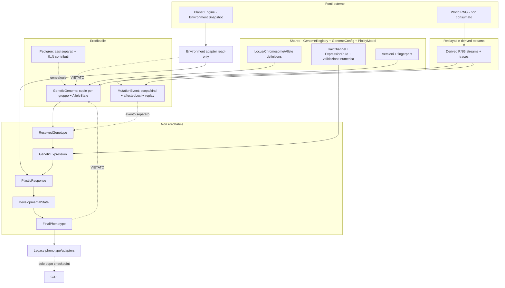

# GENOME — Architettura genetica corretta (Rev 3)

**Data:** 2026-11-20  
**Branch:** `milestone/genome/gen0-audit` — PR #4  
**Baseline GEN-0:** commit `2234eec6bb18e0ff5822247346a90461001737fd` (Rev 0), Rev 1 `2c800cf`, Rev 2 `319d975`  
**Revisione:** Rev 3, final contract hardening dopo seconda review tecnica della Rev 2.  
**Stato:** proposta architetturale **in attesa di nuova review**. Checkpoint §13 **NON APPROVATO**. Nessuna modifica al codice di produzione, a G3.1, a Planet Engine, a persistence, a workers, a `types/index.ts` o alla simulazione core.

---

## 0. Correzioni Rev 3

| Priorità | Rilievo | Correzione | Sezione |
|---|---|---|---|
| P1 | Replay RNG | `ReplayResult<T>` union discriminata: `ok` ⇒ `value: T`, `mismatches: []`; `incompatible` ⇒ `value: null`, `mismatches` espliciti non vuoti | §5, §9.2 |
| P1 | Mutazioni strutturali | Scope `point/local/interval/chromosomal`, kind distinti, `affectedLoci`/intervalli/insiemi, provenienza e stati completi; nessuna riduzione a singolo locus | §5.1 |
| P1 | Riproduzione/ploidia | Separati `ReproductionMode`, modello contributori/formazione gameti e `PloidyModel`; sessuata/asessuata compatibili con poliploidia | §2.2, §4 |
| P2 | Espressione quantitativa | Domini finiti (no NaN/Infinity), unità/semantica, pesi/normalizzazione formali, regole custom vincolate; D-01/D-07 circoscritti | §3.3, §12 |
| P2 | Ploidia per gruppo | Ploidia valutata per gruppo omologo, uniforme vs aneuploidia, riepilogo globale solo se matematicamente valido | §2.2, §9.1 |
| P2 | Sviluppo | Unità temporali, unità/semantica crescita, stadi e dati non valutabili definiti; non ereditabile | §6.3 |
| P2 | Ambiente | Coordinate/campionamento locale, coerenza temporale, stati campo uniformati; Planet Engine unica fonte autorevole; mapping concreto subordinato al contratto Planet Engine | §6.4, §9.3 |

---

## 1. Principi architetturali

1. **Definizioni ≠ istanze.** `GenomeRegistry` contiene solo definizioni condivise; l'individuo contiene solo occorrenze/stati e riferimenti versionati.
2. **Una copia cromosomica per oggetto.** `Chromosome` è una singola copia fisica; il numero di copie è determinato per gruppo omologo da `PloidyModel`.
3. **Stato allelico esplicito.** Assenza biologica, dato non disponibile e dato non valutabile sono stati distinti e non intercambiabili; vietato `null` ambiguo.
4. **Provenienza generalizzata.** Ogni copia/contributo è tracciato da `contributionId`/`contributorId`/`gameteId`; identità del contributore separata da ruoli biologici opzionali.
5. **Genotipo ereditabile immutabile.** `GeneticGenome` nasce da fondazione, ereditarietà o mutazione germinale; ambiente, espressione, sviluppo e rendering non lo modificano.
6. **Flusso unidirezionale.** Genotipo → risoluzione → espressione → regolazione ambientale → plasticità → sviluppo → fenotipo finale.
7. **Regole separate dai dati e quantitative.** Canali con unità, domini finiti, normalizzazione e conflitti espliciti.
8. **Tracciabilità e replay verificabile.** Eventi registrano provenance, versioni e traccia RNG; replay incompatibile produce errore esplicito, mai risultato valido apparente.
9. **Maturità dichiarata.** Ogni componente è `progettato`, `implementato-non-integrato`, `integrato` o `attivo` con criteri verificabili.
10. **Checkpoint prima dei contratti condivisi.** Nessuna modifica a `types/index.ts`, persistence, workers, simulazione core o renderer prima di approvazione esplicita (§13).

---

## 2. Modello genetico corretto

### 2.1 Separazione dei concetti

| Concetto | Che cos'è | Dove vive | Invariante |
|---|---|---|---|
| `LocusDefinition` | Definizione stabile di un locus | `GenomeRegistry` | ID immutabile; coordinate e parametri dichiarati |
| `AlleleDefinition` | Definizione di allele nel catalogo | `GenomeRegistry` | definizione, non occorrenza |
| `ChromosomeDefinition` | Tipo cromosomico e gruppo omologo | `GenomeRegistry` | tipo, non copia |
| `PloidyModel` | Ploidia per gruppo omologo | `GeneticGenome`/config | uniforme o aneuploide; copie coerenti per gruppo |
| `GeneticContribution` | Contributo genetico tracciabile | pedigree/gamete/copia | identità ≠ ruolo biologico |
| `Chromosome` | Singola copia cromosomica | `GeneticGenome` | una copia = un oggetto; `contributionId` |
| `AlleleState` | Stato esplicito dell'allele | `LocusCall`/evento | `identified` / `biologically-absent` / `undetermined` / `non-evaluable` |
| `GeneticGenome` | Composizione genetica effettiva | organismo | solo occorrenze individuali |
| `GenomeRegistry` | Catalogo condiviso versionato | sessione/modulo | nessun dato individuale |

### 2.2 Ploidia per gruppo omologo, copie e contributori

- `PloidyModel` è valutato **per gruppo omologo** (`HomologousGroupId`).
  - **Uniforme:** stesso numero di copie `n >= 1` per ogni gruppo dichiarato; il riepilogo globale `ploidy` è valido solo in questo caso (`globalPloidy = n`).
  - **Aneuploide:** numero di copie distinto per gruppo (`byGroup[group] >= 0` o `>= 1` secondo policy dichiarata); **nessun** riepilogo globale singolo è valido, salvo derivati espliciti per-gruppo non usati come ploidia globale.
- Per ogni gruppo, il genoma contiene esattamente le copie previste dal modello (invariante di cardinalità).
- Ogni `Chromosome` riferisce `homologousGroup`, `copyId` e `contributionId`; il contributo identifica contributore/gamete/confidenza noti o non valutabili.
- Nessun campo fisso `maternal`/`paternal`; eventuali ruoli biologici sono metadati opzionali.
- Il modello rappresenta fondatori, sessuata, asessuata, poliploidia uniforme, aneuploidia, multi-contributore e origine sconosciuta/non valutabile.

### 2.3 Stati allelici

`AlleleState` è una unione discriminata (mai `null` ambiguo):

| Stato | Significato | `alleleId` |
|---|---|---|
| `identified` | Allele presente e identificato | obbligatorio, valido |
| `biologically-absent` | Assenza biologica reale (delezione/locus perso/null-allele strutturale) | vietato |
| `undetermined` | Dato non disponibile/non ancora determinato | vietato |
| `non-evaluable` | Non valutabile nel contesto/versione | vietato |

Impatto: espressione/ereditarietà/mutazione/fenotipo devono propagare o marcare esplicitamente secondo policy dichiarata; `biologically-absent` non è dato mancante.

### 2.4 Posizione dei loci e ricombinazione

- `LocusDefinition`: `chromosomeId`, `positionBp`, `positionCm`, strand, vincoli e parametri.
- `ChromosomeDefinition`: lunghezza, centromero, tasso/ordine, supporto hotspot/interferenza.
- `RecombinationTrace`: deterministico dato input+trace RNG compatibile; registra intervalli, donatori (`copyId`/`contributionId`) e crossover.

---

## 3. Sistema di espressione componibile e quantitativo

### 3.1 Separazione definizioni / regole

- `AlleleDefinition`: proprietà/effetti con scala coerente ai canali.
- `ExpressionRule`: combinazione di stati/effetti (dominanza, dosaggio, poligenia, epistasi, pleiotropia, regolazione, interazioni). Nessuna dominanza globale per locus.
- Supporto a numero arbitrario di loci/canali/regole (nessun limite prefissato).

### 3.2 Pipeline deterministica

```text
GeneticGenome + GenomeRegistry + GenomeConfig
  → resolveAlleles      → ResolvedGenotype
  → applyExpressionRules→ contributi per canale
  → validateAndNormalize→ valori finiti, dominio, unità
  → resolveConflicts    → esito deterministico o non-evaluable esplicito
  → GeneticExpression
```

### 3.3 Contratti quantitativi (obbligatori)

- **Validità numerica:** ogni valore numerico di input/output intermedio/finale deve essere finito (`Number.isFinite`), non `NaN`, non `±Infinity`. Valore non valido ⇒ `non-evaluable` o errore secondo `clampPolicy`, mai propagato come valore valido.
- **Unità e semantica:** ogni `TraitChannelDefinition` dichiara `unit` e semantica; input/output devono essere coerenti alla scala dichiarata.
- **Intervalli e vincoli:** `domain.min <= domain.max`; policy esplicita `clamp | error | mark-non-evaluable` per fuori dominio.
- **Normalizzazione:** metodo dichiarato (`linear`, `saturating`, `none`, `custom`). Metodi standard hanno parametri e semantica documentata/versionata dal registry/engine; `custom` è ammesso solo con `customFunctionId`, `customFunctionVersion` e contratto deterministico registrato/versionato (non definibile ad hoc nel dato). Uso di `custom` non verificabile ⇒ `non-evaluable`.
- **Pesi:** pesi/regole di aggregazione dichiarati, finiti e con semantica esplicita (es. somma normalizzata o non normalizzata dichiarata); pesi mancanti/invalidi ⇒ `non-evaluable`.
- **Effetti e stati:** `biologically-absent` ⇒ contributo nullo o regola esplicita; `undetermined`/`non-evaluable` propagati secondo `missingInputPolicy` del canale.
- **Conflitti (D-01 circoscritto):** default `priority-order` con priorità esplicite; alternative (`weighted-merge`, `mark-non-evaluable`) richiedono parametri completi e deterministici. Priorità mancanti/ambigue o conflitto irrisolvibile ⇒ `mark-non-evaluable` (nessun tie-break implicito). Sintassi/DSL estesa resta fuori ambito finché non versionata in registry.
- **Catalogo canali/unità (D-07 circoscritto):** catalogo iniziale `TraitChannelDefinition` e unità normalizzate specifiche sono registry/deployment-specifici, non fissati in Rev 3; vincolanti restano i requisiti minimi del contratto (unità dichiarata, dominio finito, normalizzazione dichiarata, policy stati).

---

## 4. Pedigree, riproduzione e contributi

- **Assi separati (non mescolati in un unico enum):**
  - `ReproductionMode`: `sexual | asexual | unknown` (modalità riproduttiva).
  - `PloidyModel`: ploidia per gruppo omologo (indipendente dalla modalità).
  - `GameteFormationMode`: es. `meiotic | amitotic | apomictic | none | unknown` (modalità di formazione/trasmissione del materiale genetico).
  - Numero/contributori: `contributors: GeneticContribution[]` con cardinalità 0..N e `contributorSelectionMode` dichiarato quando pertinente.
- **Combinazioni ammesse:** sessuata o asessuata con organismi uniformemente poliploidi o aneuploidi, se `PloidyModel` e `GameteFormationMode` lo supportano; nessuna combinazione implicita.
- `PedigreeRecord`: 0..N contributi, identità separata da ruolo, tracciabilità gamete/contributionId, genealogie parziali (`known/partial/unknown/non-evaluable`).
- Nessun ciclo; metriche dipendenti da rami ignoti/non valutabili ⇒ `NON_EVALUABLE`.

---

## 5. Tracciabilità mutazioni e replay

### 5.1 Mutazioni puntiformi, locali, a intervallo, cromosomiche

- `MutationScope`: `point | local | interval | chromosomal`.
- `MutationKind`: distinti e coerenti con lo scope (es. `substitution`, `insertion`, `deletion`, `duplication`, `inversion`, `translocation`, `regulatory`, `complex`).
- Ogni evento rappresenta gli elementi coinvolti tramite `affectedLoci` (insieme ordinato, almeno un elemento) con, per ciascuno, `locusId`, intervallo/posizione se applicabile, `previousState: AlleleState`, `resultingState: AlleleState`.
- Eventi a intervallo/cromosomici includono `affectedInterval` e/o insieme di loci/intervalli e, se rilevante, copie cromosomiche coinvolte; **non** sono riducibili a un singolo locus.
- `previousState`/`resultingState` completi preservati per tutti gli elementi coinvolti; provenienza (`origin`, `causedBy`), contributo/copia, versioni e `RngTrace` sempre presenti.
- Effetti fenotipici (`ExpressionDelta`) e fitness (`FitnessAssessment`, `NON_EVALUABLE` per default) restano artefatti separati.

### 5.2 Replay deterministico

- `ReplayResult<T>` union discriminata:
  - `status: "ok"` ⇒ `value: T` non nullo, `mismatches: []`.
  - `status: "incompatible"` ⇒ `value: null`, `mismatches` espliciti e non vuoti (campo, atteso, osservato).
- Compatibilità verificata su: algoritmo/versione RNG, parametri/hash evento, registry id/version/fingerprint, engine version, schema version e contesto richiesto.
- Incompatibilità ⇒ nessun fallback silenzioso, nessun replay eseguito come valido, nessun risultato valido apparente.

---

## 6. Contratti distinti e ambiente

| # | Contratto | Ruolo | Scrive genotipo? | Ereditabile? |
|---|---|---|---|---|
| 1 | `GeneticGenome` | Genotipo ereditabile | sorgente | sì |
| 2 | `ResolvedGenotype` | Risoluzione stati/dosaggi | no | no |
| 3 | `GeneticExpression` | Potenziale genetico quantitativo | no | no |
| 4 | `EnvironmentalSnapshot` | Contesto ambientale da Planet Engine | no | no |
| 5 | `PlasticResponse` | Risposta non ereditaria | no | no |
| 6 | `DevelopmentalState` | Stato ontogenetico | no | no |
| 7 | `FinalPhenotype` | Fenotipo finale per canale | no | no |

### 6.3 Sviluppo

- `DevelopmentalState` dichiara unità temporali (`ageUnit`, `age`, `tickReference`) e semantica/unità di ogni metrica in `growth` (es. `value`, `unit`, `status`).
- Stadi (`stage`) sono valori dichiarati/versionati dal modello di sviluppo; transizioni non implicite.
- Dati non valutabili nello sviluppo sono rappresentati esplicitamente (`status: "undetermined" | "non-evaluable"` con motivo) e non sostituiti da valori validi.
- Sviluppo e plasticità sono sempre non ereditabili.

### 6.4 Fonte ambientale (Planet Engine)

- Fonte autorevole unica: **Environment Snapshot del Planet Engine** (contratto di integrazione/versionato).
- GENOME non crea né mantiene un modello ambientale parallelo: può solo leggere/normalizzare tramite adattatore documentato.
- Contratto richiesto: identificativi producer/snapshot/contract, riferimento temporale e coerenza temporale (istantanea o intervallo dichiarato), coordinate/riferimento spaziale e modalità di campionamento locale/granularità, campi con unità, provenienza e stato uniforme.
- **Stati campo ambientale uniformati:** ogni campo espone `status: "value" | "missing" | "non-evaluable"`, `provenance: "OBSERVED" | "DERIVED"` (quando applicabile), `value`/`unit`/`reason` coerenti; `missing` ≠ `non-evaluable`.
- Mapping concreto campo-per-campo subordinato al contratto Planet Engine (D-14).

---

## 7. Diagramma dei flussi



---

## 8. Matrice delle responsabilità

| Responsabilità | Modulo proposto | Appartenenza | Mutabile da | Serializzato | Maturità attuale |
|---|---|---|---|---|---|
| Definizioni registry/canali/regole | `simulation/genome/registry.ts` | Registry | nuova versione | id+versioni | **progettato** |
| Config, ploidia per gruppo, versioni | `simulation/genome/config.ts` | Registry/sessione | config versionata | id+versioni | **progettato** |
| Genotipo e stati allelici | `simulation/genome/genotype.ts` | Organismo | fondazione/eredità/mutazione | sì | **progettato** |
| Validazione numerica/contratti | `simulation/genome/validate.ts` | Infrastruttura | — | no | **progettato** |
| Contributi, gameti, ricombinazione | `simulation/genome/recombination.ts`, `pedigree.ts` | Organismo | nascita/trasmissione | sì (trace) | **progettato** |
| Mutazioni e replay | `simulation/genome/mutation.ts`, `rng.ts` | Organismo/sessione | mutazione/evento | eventi+trace | **progettato** |
| Risoluzione/espressione quantitativa | `simulation/genome/resolution.ts`, `expression.ts` | Derivato | — | no | **progettato** |
| Adattamento ambiente Planet Engine | `simulation/genome/environment.ts` | Derivato/adattatore | — | no | **progettato** |
| Sviluppo/fenotipo finale | `simulation/genome/development.ts` | Derivato | — | no | **progettato** |
| Serializzazione/migrazione | `simulation/genome/serialization.ts`, `migration.ts` | Infrastruttura | — | sì | **progettato** |
| Integrazione live simulazione | `simulation/core/*`, `reproduction.ts` | Core | PR future con checkpoint | n/a | **non avviata** |

Nessun modulo GENOME è implementato, integrato o attivo nel codice di produzione in Rev 3.

---

## 9. Config, RNG, ambiente, serializzazione, versionamento

### 9.1 GenomeConfig e ploidia

- `GenomeConfig` dichiara: versioni, registry, `PloidyModel`/gruppi, strategia fondatori, regole mutazione/ricombinazione/formazione gameti, canali, pipeline, policy stati mancanti/non valutabili, compatibilità, RNG, riferimento contratto Planet Engine.
- **Invarianti ploidia:** per ogni gruppo, copie presenti = valore previsto da `PloidyModel`; riepilogo globale solo se uniforme; aneuploidia esplicita senza globale implicito.
- Versioni/fingerprint obbligatori: `schemaVersion`, `registryVersion`, `engineVersion`, `rngAlgorithmVersion` (se applicabile), `planetEnvironmentContractVersion`.

### 9.2 RNG e replay deterministico

- Stream derivati dal world RNG con namespace/salt dichiarati; world RNG non consumato dal replay interno.
- `RngTrace` include algoritmo, versione, seed/root, namespace, salt, stato prima/dopo, draw count, engine version.
- Compatibilità richiesta su algoritmo/versione RNG, parametri/hash, registry fingerprint/version, engine/schema/contesto.
- `ReplayResult<T>`: `ok` con valore; `incompatible` con `value: null` e mismatch espliciti non vuoti; nessun risultato valido apparente.

### 9.3 EnvironmentalSnapshot (Planet Engine)

- Identificazione: `source: "planet-engine"`, producer, contract/snapshot version.
- **Coerenza temporale:** `tick`/riferimento e modalità (`instant` o intervallo con inizio/fine) dichiarata.
- **Coordinate e campionamento locale:** sistema di coordinate, riferimento spaziale, granularità, metodo di campionamento (es. cella/punto/raggio/area) e parametri necessari.
- **Campi:** unità, `provenance` (`OBSERVED|DERIVED`), `status` (`value|missing|non-evaluable`), valore finito quando `value`, motivo quando non valorizzabile.
- Adattatore read-only; mapping concreto subordinato al contratto Planet Engine.

### 9.4 Serializzazione e migrazione

- Serializzare solo id/versioni/fingerprint + occorrenze individuali, incluse copie per gruppo, `AlleleState`, contributi e `affectedLoci`/intervalli mutazionali.
- Migrazione monotonica e idempotente; versioni non supportate ⇒ `unsupported`/`NON_EVALUABLE` esplicito.
- `biologically-absent`, `undetermined`, `non-evaluable` e stati campo ambientali preservati senza collasso semantico.

---

## 10. Maturità, fasi e criteri verificabili

| Livello | Definizione | Criteri verificabili |
|---|---|---|
| **Progettato** | Definito in documentazione/contratti | tipi/invarianti/flussi/test plan presenti; nessun codice operativo dichiarato |
| **Implementato (non integrato)** | Scaffolding isolato | modulo presente, API conforme, test unitari verdi, nessun call-site live |
| **Integrato** | Collegato ma non necessariamente attivo | wiring/flag documentati, test integrazione verdi, default legacy invariato se disattivato |
| **Attivo/Operativo** | Effettivo nel percorso live previsto | abilitazione supportata, end-to-end/regressione/osservabilità, baseline confrontata |

**Stato attuale (Rev 3):** tutti i componenti Genome Engine sono **progettati**. Nessun modulo è implementato, integrato o attivo. GEN-1/2/3 non rappresentano funzionalità operative.

| Fase | Natura | Significato |
|---|---|---|
| GEN-0 Rev 3 | documentale | hardening contrattuale per nuova review |
| GEN-1 (futura) | predisposizione isolata | scaffolding/test isolati; **non** meiosi/mutazione/pedigree operativi |
| GEN-2 (futura) | integrazione/attivazione | ereditarietà/pedigree controllati, dopo checkpoint e PR dedicata |
| GEN-3 (futura) | integrazione/attivazione | mutazioni nel flusso previsto, replay e effetti separati |

---

## 11. Integrazione con sistemi esistenti

- Vettore legacy 33 geni, fallback blending, G3.1, persistence, workers e core restano invariati.
- Nessuna integrazione con Planet Engine implementata: solo contratto di riferimento/adattatore progettato.
- Innesti futuri (es. `runtimeAnatomyRenderSource.ts:270-284`) solo dopo checkpoint §13.

---

## 12. Decisioni ancora aperte

| ID | Decisione | Stato | Nota Rev 3 |
|---|---|---|---|
| D-01 | DSL/sintassi avanzata di conflitti oltre strategia default | **APERTA (circoscritta)** | default `priority-order` + `mark-non-evaluable` su ambiguità definito; estensioni versionate future |
| D-02 | Dettagli mappatura copie/contributi in casi di ploidia/aneuploidia complessa | **APERTA** | invarianti per-gruppo e tracciabilità contributi definiti; mapping operativo specifico da dettagliare |
| D-03 | Fallback dichiarato specifico per canali con input mancanti/non valutabili | **APERTA** | policy e stati definiti; valori/funzioni fallback per canale restano registry-specifici |
| D-04 | Rappresentazione di assenze strutturali complesse multi-allele | **APERTA** | `biologically-absent` e scope mutazionale definiti; codifica casi complessi da dettagliare |
| D-05 | Generazione nuovi stati/alleli da mutazione strutturale | **APERTA** | evento deve registrare previous/resulting; strategia generativa da definire |
| D-06 | Pinning registry/config/environment contract negli snapshot | **APERTA** | fingerprint/versioni richieste; meccanismo di pinning operativo da definire |
| D-07 | Catalogo iniziale `TraitChannelDefinition` e unità normalizzate specifiche | **APERTA (circoscritta)** | requisiti minimi/unità dichiarata vincolanti; catalogo concreto registry-specifico |
| D-08 | Metrica compatibilità post R-01 | **APERTA** | non bloccante per Rev 3 |
| D-09 | Distinzione germinale/somatica nel modello di simulazione | **APERTA** | `MutationOrigin` già distinto |
| D-10 | Budget memoria/costo per N elevato | **APERTA** | richiede misure |
| D-11 | Serializzazione replay trace voluminosi | **APERTA** | campi minimi definiti |
| D-12 | Coinvolgimento di `plantGenome.ts` | **APERTA** | fuori perimetro |
| D-13 | Approvazione checkpoint §13 | **APERTA** | prerequisito per modifiche shared |
| D-14 | Mapping concreto verso Environment Snapshot del Planet Engine | **APERTA** | subordinato al contratto Planet Engine; requisiti minimi definiti |

---

## 13. Checkpoint di architettura

Prima di qualsiasi modifica a `types/index.ts`, `simulation/core/world.ts`, `reproduction.ts`, persistence, workers, `lib/anatomy/**`, `lib/phenotype/**`, renderer, `RenderFrame` o `WorldSnapshot` è necessario:

1. aggiornare questo documento con impatto esatto;
2. ottenere approvazione esplicita della nuova review;
3. aprire PR dedicata su `milestone/genome/*`;
4. eseguire e allegare `tsc`, test mirati, E2/G3, build e confronto con baseline quiescente.

**Stato corrente: CHECKPOINT NON APPROVATO.**

**Conferma esplicita Rev 3:** nessun file di codice di produzione modificato; nessuna modifica a G3.1, Planet Engine, persistence, workers, simulazione core o shared core; nessuna integrazione; nessun avvio GEN-1; nessun merge; `main` resta `5672f12296e484a4ba02ba2876e2f5e82d266cb1`.
